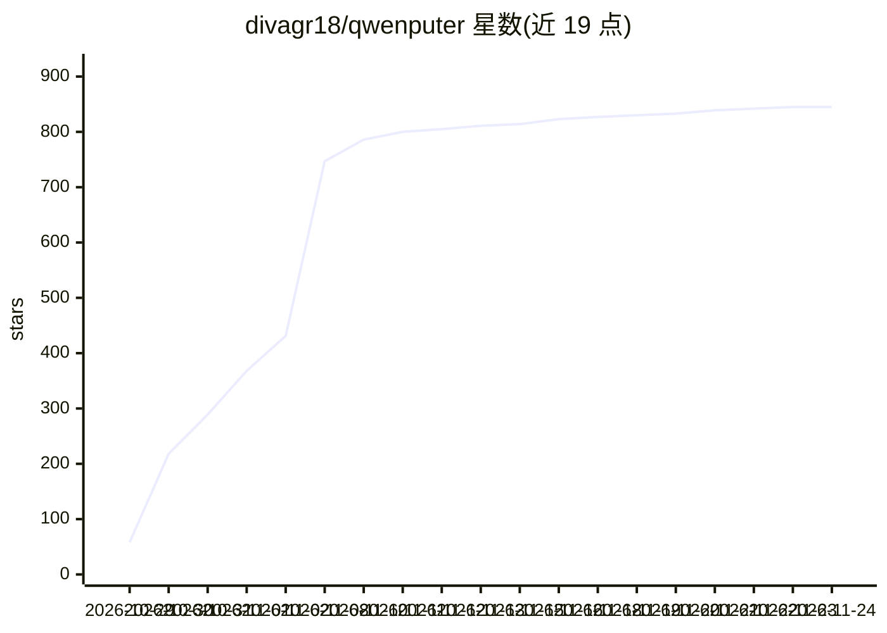

# divagr18/qwenputer

⭐ 845 · Python · NOASSERTION · 推送 2026-11-19 · [GitHub](https://github.com/divagr18/qwenputer) · 个人维护

**将 RISC-V CPU 编译进 Qwen 权重的实验性语言模型**

Qwenputer 在 Qwen3.5-4B 权重中编译入一个 32 位 RISC-V CPU，CPU 层位于 Qwen 自身 11 层 transformer 之前，全部权重由编译器计算而非学习。机器以模型的 Gated DeltaNet 状态作为 RAM，用 one-hot 键/查询实现逐行读写。模型在前向传播内运行 C 与 MicroPython 代码，通过 riscv-tests 测试集，对外仍加载为标准 Qwen 检查点，无需外部工具执行器。衍生实验包括权重内 NPU、文件系统与 CHIP-8 版本；仓库提供 git clone + uv 的快速启动流程，推理依赖 Triton 执行器与 GPU。

## 筛选速览

| 维度 | 判定 | 备注 |
|---|---|---|
| AI 角色 | `ai-native` | 本体是模型或模型工具 |
| 许可风险 | `none` | NOASSERTION |
| 部署形态 | `None` |  |
| 模型依赖 | — | README 未给出锁定关系 |
| 硬件要求 | — | 无带数字的原话,不猜 |
| 安装摩擦 | `low` | 无编译、无系统依赖或容器化 |
| 成熟度 | `idea` | |

## 能力要点

- 32 位 RISC-V CPU 编译进 Qwen3.5-4B 权重，Gated DeltaNet 状态作 RAM
- 模型内部运行 C 与 MicroPython 代码，通过 riscv-tests 套件
- 以标准 Qwen3_5ForCausalLM 加载，CPU 调用不经过外部工具执行器
- 实验分支含权重内 NPU、权重内文件系统与 CHIP-8 版本

## 适用场景

- 让 Qwen3.5-4B 在权重内精确执行大数算术运算
- 在模型内部保存与读取跨会话的文件（文件系统实验）
- 研究编译进权重的可解释性电路与 DeltaNet 状态用法

## 场景标签

 · 领域:AI 模型/实验研究

## 证据(README 行号)

> L9: **Qwenputer is a new kind of experimental model: Qwen3.5-4B with a 32-bit RISC-V CPU compiled and
> L14: It uses the model's own Gated DeltaNet state as RAM. Qwen3.5's DeltaNet layers carry a running
> L18: The CPU runs C and MicroPython code inside the model's forward passes, and passes the official

## 星数曲线

2026-10-29 58 → 2026-11-24 845（+787）

---
*卡片 v1 · prompt 1.4 · 生成 2026-11-24 · 置信度 high · 依据 README sha `8f540838c371` · [字段定义](../../DATASET.md)*
