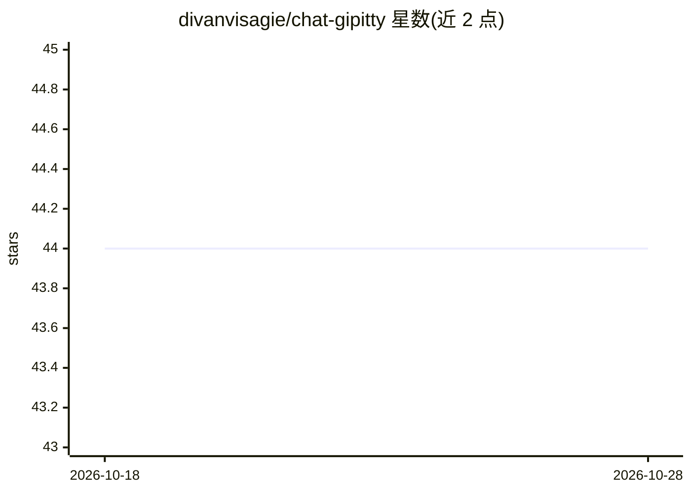

# divanvisagie/chat-gipitty

⭐ 44 · Rust · BSD-3-Clause · 推送 2025-12-08 · [GitHub](https://github.com/divanvisagie/chat-gipitty) · [官网](https://divanv.com/chat-gipitty) · 个人维护

**终端里调用 LLM 的命令行客户端，支持管道输入**

Rust 编写的命令行工具 cgip，面向 OpenAI Chat Completions API 及任何 OpenAI 兼容端点（Ollama 本地模型、Gemini、Mistral、Claude 等）。用户在终端向模型提问，可将命令输出通过管道送入模型分析（如调试 Rust 编译错误），并用 shell 别名组合出翻译、代码审查等工具。支持多模态（文本、图像分析、TTS）、会话管理、网页搜索与可执行 shell 命令的 agent 模式。通过 cargo install 安装，需设置 OPENAI_API_KEY。

## 筛选速览

| 维度 | 判定 | 备注 |
|---|---|---|
| AI 角色 | `ai-ecosystem` | LLM/agent 周边工具 |
| 许可风险 | `permissive` | BSD-3-Clause |
| 部署形态 | `library` | 以包/库形式分发 |
| 模型依赖 | local-ok | 支持本地模型 |
| 硬件要求 | — | 无带数字的原话,不猜 |
| 安装摩擦 | `low` | 无编译、无系统依赖或容器化 |
| 成熟度 | — | 结构信号不足 |

## 能力要点

- 管道输入：命令输出直接送入模型分析
- 多模态：文本、图像分析、文本转语音
- 会话管理、网页搜索与可执行 shell 命令的 agent 模式
- 兼容任何实现 OpenAI Chat Completions 标准的服务（含本地 Ollama）

## 适用场景

- 把编译报错或日志管道给模型做快速分析
- 用 shell 别名组合出翻译、代码审查等命令行小工具
- 在终端使用本地 Ollama 或其他 OpenAI 兼容模型

## 场景标签

`AI 助手` `代码审查` · 领域:编码与开发

## 证据(README 行号)

> L4: Chat Gipitty (Chat Get Information, Print Information TTY) is a command line client primarily intended for the **off
> L49: - **Universal AI Access**: Works with OpenAI, local models via Ollama, Google Gemini, Mistral AI, Anthropic Claude,

## 星数曲线

2026-10-18 44 → 2026-10-28 44（+0）

---
*卡片 v1 · prompt 1.4 · 生成 2026-10-25 · 置信度 high · 依据 README sha `8a009ed3dedb` · [字段定义](../../DATASET.md)*
