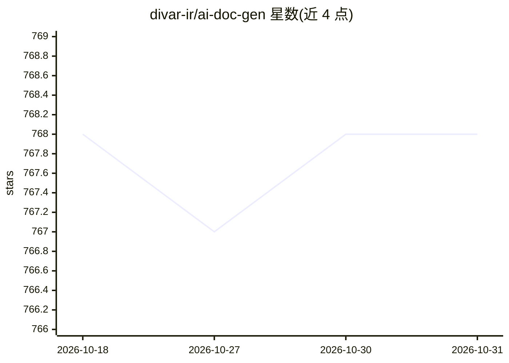

# divar-ir/ai-doc-gen

⭐ 768 · Python · MIT · 推送 2026-07-21 · [GitHub](https://github.com/divar-ir/ai-doc-gen) · 组织维护

**多 agent 代码库分析与文档生成系统，产出 README 与 AI 助手配置**

基于 pydantic-ai 的多 agent 系统：五个专项分析 agent 并发解析代码结构、依赖、数据流、请求流与 API，生成文档写入 .ai/docs/，再由生成 agent 产出 README.md 及 AI 助手配置（CLAUDE.md、AGENTS.md、Cursor rules）。支持任意 OpenAI 兼容 API，可按 agent 配置模型与端点；提供 GitLab cronjob 模式自动发现活跃项目并发起 merge request。以 Claude Code 插件（含三个 skills）或 Python CLI 方式使用，附 Dockerfile 与 Helm chart。面向开发者与团队自动化文档维护。

## 筛选速览

| 维度 | 判定 | 备注 |
|---|---|---|
| AI 角色 | `ai-ecosystem` | LLM/agent 周边工具 |
| 许可风险 | `permissive` | MIT |
| 部署形态 | `self-host` | docker 或自建部署 |
| 模型依赖 | — | README 未给出锁定关系 |
| 硬件要求 | — | 无带数字的原话,不猜 |
| 安装摩擦 | `low` | 无编译、无系统依赖或容器化 |
| 成熟度 | — | 结构信号不足 |

## 能力要点

- 五个专项分析 agent 并发执行，产出 .ai/docs/ 分析文档
- 生成 README.md 与 CLAUDE.md/AGENTS.md/Cursor rules
- Claude Code 插件形态提供 analyze-codebase 等三个 skills
- GitLab cronjob 模式自动分析项目并发起 merge request

## 适用场景

- 为存量代码库自动生成与更新 README
- 为 Claude/Cursor 等 AI 编码助手生成项目规则文件
- GitLab 定时任务批量刷新团队项目的文档

## 场景标签

`多智能体` `AI 写作` · 领域:Agent 开发

## 证据(README 行号)

> L3: An AI-powered code documentation generator that automatically analyzes repositories and creates comprehensive docume
> L18: - **Claude Code Plugin & Skills**: Ships as an installable Claude Code plugin with `analyze-codebase`, `generate-re
> L164: - **Python 3.13** with pydantic-ai for AI agent orchestration

## 星数曲线

2026-10-18 768 → 2026-10-31 768（+0）

---
*卡片 v1 · prompt 1.4 · 生成 2026-10-21 · 置信度 high · 依据 README sha `fb2693572eb4` · [字段定义](../../DATASET.md)*
