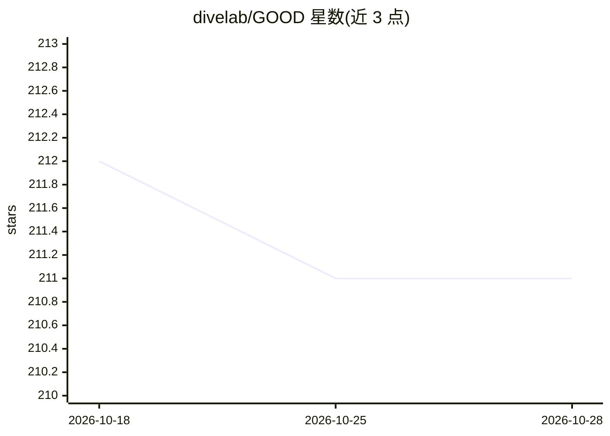

# divelab/GOOD

⭐ 211 · Python · GPL-3.0 · 推送 2026-10-15 · [GitHub](https://github.com/divelab/GOOD) · [官网](https://good.readthedocs.io/) · 组织维护

**图分布外（OOD）算法基准库：供科研者开发评测图 OOD 算法**

NeurIPS 2022 Datasets and Benchmarks Track 收录的图分布外基准库，基于 PyTorch 与 PyG 构建。收录 11 个数据集、17 个域选择、51 种划分，提供 12 种基线方法（含 6 种图专用方法）的 10 轮运行结果与排行榜。提供 goodtg CLI 运行算法、goodtl CLI 做多 GPU 超参扫描、结果收集与最佳配置更新；数据集首次运行时从 Hugging Face 镜像自动下载，支持离线模式。用户可注册自有算法/模型/数据集并与排行榜对比。

## 筛选速览

| 维度 | 判定 | 备注 |
|---|---|---|
| AI 角色 | `ai-ecosystem` | LLM/agent 周边工具 |
| 许可风险 | `viral` | GPL-3.0 |
| 部署形态 | `library` | 以包/库形式分发 |
| 模型依赖 | — | README 未给出锁定关系 |
| 硬件要求 | — | 无带数字的原话,不猜 |
| 安装摩擦 | `medium` | 含编译或系统依赖之一 |
| 成熟度 | — | 结构信号不足 |

## 能力要点

- 11 个数据集、17 个域选择、共 51 种 OOD 划分
- 12 种基线方法结果（含 6 种图专用方法），每方法 10 次随机运行
- goodtg 运行任务、goodtl 支持多 GPU 超参扫描与结果采集
- 数据集从 Hugging Face 镜像自动下载，固定快照保证可复现

## 适用场景

- 开发和评测新的图分布外泛化算法
- 将自己的算法结果与基准排行榜对比
- 在多个数据集与移位类型上做超参扫描实验

## 场景标签

`模型评测` `科研工具` · 领域:评测与运维

## 证据(README 行号)

> L51: **GOOD** (Graph OOD) is a graph out-of-distribution (OOD) algorithm benchmarking library depending on PyTorch and P
> L63: Whether you are an experienced researcher of graph out-of-distribution problems or a first-time learner of graph de

## 星数曲线

2026-10-18 212 → 2026-10-28 211（-1）

---
*卡片 v1 · prompt 1.4 · 生成 2026-10-22 · 置信度 mid · 依据 README sha `ed5aa7f474ce` · [字段定义](../../DATASET.md)*
