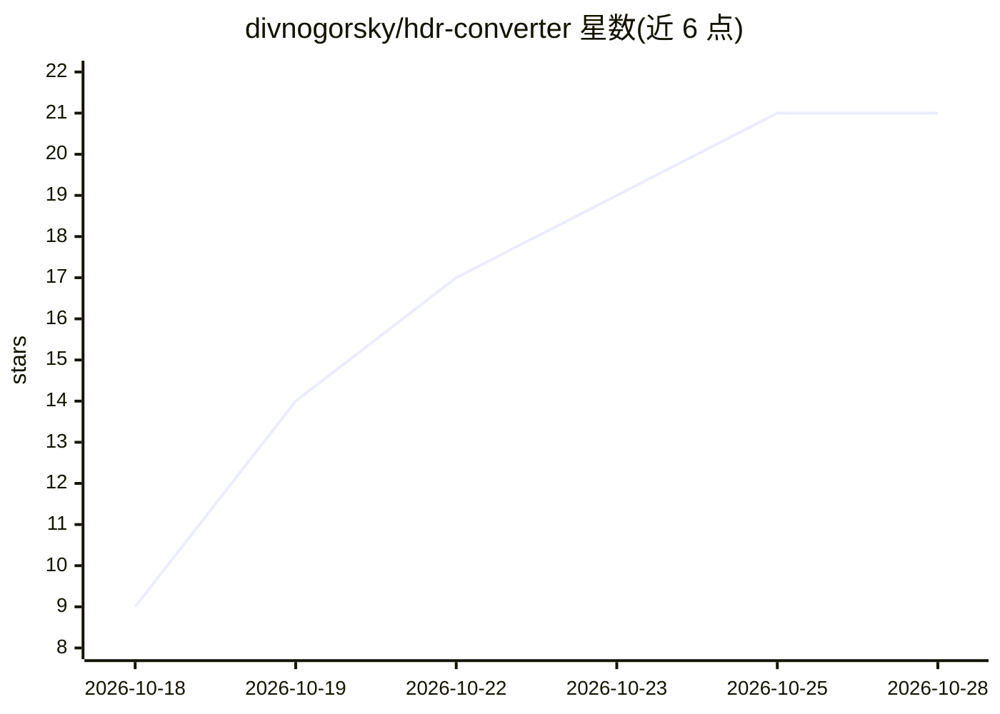

# divnogorsky/hdr-converter

⭐ 21 · NOASSERTION · 推送 2026-10-14 · [GitHub](https://github.com/divnogorsky/hdr-converter) · 个人维护

**本地将 SDR 视频转换为 HDR EXR 的桌面工具**

面向 AI 生成视频的本地 SDR→HDR 转换工具：基于 LTX-2.5 22B 模型与 Lightricks 的 SDR→HDR IC-LoRA，重建被削平的高光，其余画面保持原样；长镜头分块处理并自动拼接。输出 ACEScg OpenEXR 序列，并附带深度、法线、运动矢量与主体 matte 等 comp 通道。以 Windows 安装程序分发，需 NVIDIA GPU（单张 10 GB 显存可跑 4K），模型安装时从 Hugging Face 下载，受 LTX-2 Community License 约束（年营收超 1000 万美元需商业授权）。当前为 beta 版。

## 筛选速览

| 维度 | 判定 | 备注 |
|---|---|---|
| AI 角色 | `ai-native` | 本体是模型或模型工具 |
| 许可风险 | `none` | NOASSERTION |
| 部署形态 | `desktop` | 安装包/桌面程序 |
| 模型依赖 | — | README 未给出锁定关系 |
| 硬件要求 | — | 无带数字的原话,不猜 |
| 安装摩擦 | `low` | 无编译、无系统依赖或容器化 |
| 成熟度 | `idea` | |

## 能力要点

- 基于 LTX-2.5 22B 与 SDR→HDR IC-LoRA 的高光重建，单张 10 GB GPU 支持 4K
- 输出 ACEScg OpenEXR 序列及深度/法线/运动矢量/主体 matte 等 comp 通道
- 本地运行，素材不上传云端
- 可复用已有 ComfyUI 中的 LTX 模型

## 适用场景

- 把 AI 生成的 SDR 视频转成 HDR EXR 用于合成与交付
- 为合成流程生成深度、法线、运动矢量等辅助通道
- 在不改动已批准画面的前提下仅修复过曝高光

## 场景标签

`图像视频处理` · 领域:感知与多模态

## 证据(README 行号)

> L5: **Local SDR → HDR EXR conversion for AI-generated video — plus depth, normals, motion vectors and a hero matte for
> L51: installer. HDR Converter is built on **LTX-2.5** and the **SDR→HDR IC-LoRA** by Lightricks.

## 星数曲线

2026-10-18 9 → 2026-10-28 21（+12）

---
*卡片 v1 · prompt 1.4 · 生成 2026-10-28 · 置信度 high · 依据 README sha `f5f17cea25d0` · [字段定义](../../DATASET.md)*
