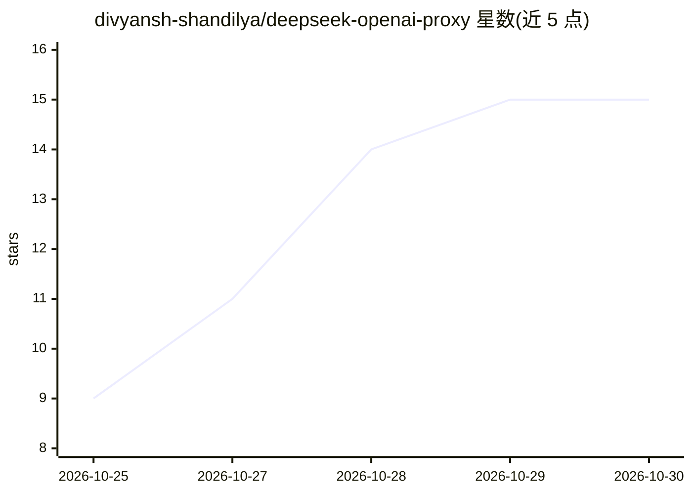

# divyansh-shandilya/deepseek-openai-proxy

⭐ 15 · JavaScript · MIT · 推送 2026-10-27 · [GitHub](https://github.com/divyansh-shandilya/deepseek-openai-proxy) · [官网](https://deepseek-setup.antigravity-cloudflare-worker.workers.dev/) · 个人维护

**本地代理：把 DeepSeek 网页会话转成 OpenAI 兼容接口**

名为 freeseek 的本地 Node 代理，将 DeepSeek R1/V3 的消费者网页 API（chat.deepseek.com）封装为 OpenAI 兼容端点，供 Cursor、Cline、Roo Code、Continue 及任意 OpenAI SDK 应用接入；支持流式输出与工具调用（文件读写、终端、代码编辑）的翻译。凭据使用浏览器提取的 DeepSeek 会话 token，明文存于 ~/.freeseek/config.json；默认仅绑定 127.0.0.1。README 声明限制：依赖非官方消费者接口，可能违反 DeepSeek 服务条款导致账号受限，网页端限速仍然适用。

## 筛选速览

| 维度 | 判定 | 备注 |
|---|---|---|
| AI 角色 | `ai-ecosystem` | LLM/agent 周边工具 |
| 许可风险 | `permissive` | MIT |
| 部署形态 | `library` | 以包/库形式分发 |
| 模型依赖 | locked-api |  |
| 硬件要求 | — | 无带数字的原话,不猜 |
| 安装摩擦 | `low` | 无编译、无系统依赖或容器化 |
| 成熟度 | — | 结构信号不足 |

## 能力要点

- 将 DeepSeek 网页会话转译为 OpenAI 兼容 /v1 端点
- 支持流式输出与编码代理工具调用翻译
- npm 一条命令全局安装，默认仅回环地址监听
- token 仅存本地，请求不经过第三方服务器

## 适用场景

- 在 Cursor/Cline/Continue 中使用自己的 DeepSeek 账号作为模型后端
- 让任意 OpenAI SDK 应用以兼容接口调用 DeepSeek
- 本地零订阅成本地使用 DeepSeek R1/V3

## 场景标签

`模型网关` · 领域:Agent 开发

## 证据(README 行号)

> L1: # freeseek - Local DeepSeek OpenAI-Compatible Proxy
> L5: Connect DeepSeek directly into **Cursor**, **VS Code / Cline**, **Roo Code**, **Continue**, or any OpenAI SDK applic

## 星数曲线

2026-10-25 9 → 2026-10-30 15（+6）

---
*卡片 v1 · prompt 1.4 · 生成 2026-10-30 · 置信度 high · 依据 README sha `5dc81eb4b0ef` · [字段定义](../../DATASET.md)*
