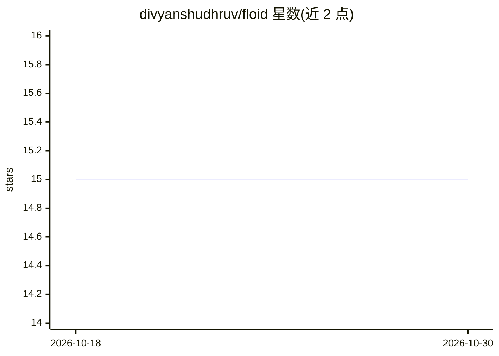

# divyanshudhruv/floid

⭐ 15 · TypeScript · MIT · 推送 2026-03-04 · [GitHub](https://github.com/divyanshudhruv/floid) · [官网](https://floid.vercel.app) · 个人维护

**面向提示工程社区的提示词分享与讨论 Web 平台**

Floid 是一个基于 Next.js 15 与 Supabase 构建的线程式提示词分享网站：用户可以创建、分享、讨论面向 GPT、图像生成等工具的提示词。功能包括实时动态（Supabase 订阅）、Google OAuth 登录、提示词卡片（标签、模型图标、作者、点击计数、复制/预览）、仅作者可编辑/删除、API 为未来计划。README 声明产品处于 beta 阶段，本地开发需 Node.js 18+、npm/yarn 与 Supabase 账号，通过 git clone 与 npm install 运行开发服务器。

## 筛选速览

| 维度 | 判定 | 备注 |
|---|---|---|
| AI 角色 | `ai-ecosystem` | LLM/agent 周边工具 |
| 许可风险 | `permissive` | MIT |
| 部署形态 | `library` | 以包/库形式分发 |
| 模型依赖 | — | README 未给出锁定关系 |
| 硬件要求 | — | 无带数字的原话,不猜 |
| 安装摩擦 | `low` | 无编译、无系统依赖或容器化 |
| 成熟度 | `idea` | |

## 能力要点

- 线程式提示词创建、分享与讨论
- Supabase 实时订阅展示新提示词与评论
- Google OAuth 用户认证与作者编辑/删除权限
- 提示词卡片含标签、模型图标、点击计数与复制/预览

## 适用场景

- 提示词创作者发布并社区讨论自己的提示词
- 按模型标签（ChatGPT、Gemini 等）发现提示词
- 提示工程爱好者社区交流与迭代提示词

## 场景标签

`提示工程` · 领域:Agent 开发

## 证据(README 行号)

> L3: Floid is a **`modern 🔥`** platform where anyone can **`create ✒️`**, **`share 📩`**, and **`discover 🧭`** prompts for
> L13: **Floid** is the first **`open prompt network for everyone`**. Users can **`generate`**, **`share`**, and **`discus

## 星数曲线

2026-10-18 15 → 2026-10-30 15（+0）

---
*卡片 v1 · prompt 1.4 · 生成 2026-10-30 · 置信度 mid · 依据 README sha `e41333ffa106` · [字段定义](../../DATASET.md)*
