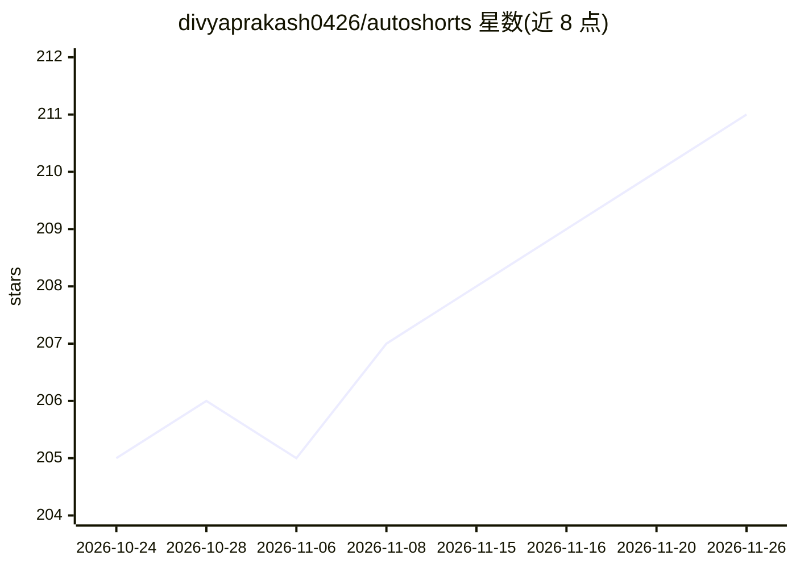

# divyaprakash0426/autoshorts

⭐ 211 · Python · Apache-2.0 · 推送 2026-11-05 · [GitHub](https://github.com/divyaprakash0426/autoshorts) · 个人维护

**把长视频自动剪成竖屏短片段的 AI 工具**

面向游戏录像等多类长视频的自动化剪辑工具：AI 分析选出精彩时刻后，执行裁剪、字幕、配音与竖屏渲染。支持 15 种内容预设，分析可选 Gemini/OpenAI 视觉模型或本地启发式；转录用 Whisper，配音用本地 Qwen3-TTS；渲染走 CUDA/NVENC，无 CUDA 时回退 libx264。提供 Streamlit 仪表盘与 CLI，支持 Docker。要求 NVIDIA GPU、CUDA 工具链与 NVENC 版 FFmpeg。

## 筛选速览

| 维度 | 判定 | 备注 |
|---|---|---|
| AI 角色 | `ai-native` | 本体是模型或模型工具 |
| 许可风险 | `permissive` | Apache-2.0 |
| 部署形态 | `None` |  |
| 模型依赖 | — | README 未给出锁定关系 |
| 硬件要求 | `gpu-8g` | |
| 安装摩擦 | `high` | 编译与系统依赖俱全 |
| 成熟度 | — | 结构信号不足 |

## 能力要点

- 15 种内容预设的时刻选取，支持 Gemini/OpenAI 或本地启发式分析
- Whisper 转录与本地 Qwen3-TTS 多语言配音
- CUDA 解码与 NVENC 编码的 GPU 渲染，含 CPU 回退
- Streamlit 仪表盘管理视频队列与生成片段

## 适用场景

- 把游戏录像自动剪成竖屏短片
- 为播客和访谈生成分发用的短视频片段
- 给生成的片段加 AI 字幕与旁白配音

## 场景标签

`语音合成` `语音识别` `图像视频处理` · 领域:内容生成

## 证据(README 行号)

> L3: Turn long-form videos into short clips with AI-assisted moment selection,
> L22: - **Flexible analysis:** Gemini, including full-video deep analysis; OpenAI vision;

## 星数曲线

2026-10-24 205 → 2026-11-26 211（+6）

---
*卡片 v1 · prompt 1.4 · 生成 2026-11-25 · 置信度 high · 依据 README sha `53685bccd225` · [字段定义](../../DATASET.md)*
