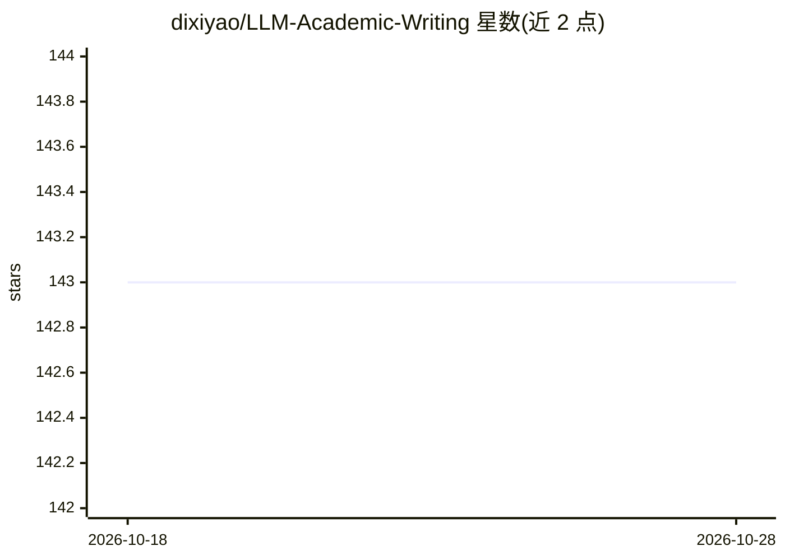

# dixiyao/LLM-Academic-Writing

⭐ 143 · TypeScript · Apache-2.0 · 推送 2026-05-24 · [GitHub](https://github.com/dixiyao/LLM-Academic-Writing) · 个人维护

**学术写作 LLM 工具集：PDF 论文多智能体审稿与语法润色**

研究如何用 LLM 辅助学术写作的公开仓库，核心是 AIReviewer：本地、PDF 优先的智能体审稿工作区，导入论文 PDF 后选择 ICLR/NeurIPS/ICML 评审标准，生成结构化多智能体审稿意见，支持行内高亮、针对建议或选中文本的对话与 rebuttal，数据以本地 SQLite 持久化；审稿引擎主用 Gemini，OpenRouter 作为回退。另含基于 GPT-4 的论文评审生成器与语法检查器，README 还整理了 LLM 选型、提示词与插件清单。通过 npm 安装本地运行。

## 筛选速览

| 维度 | 判定 | 备注 |
|---|---|---|
| AI 角色 | `ai-native` | 本体是模型或模型工具 |
| 许可风险 | `permissive` | Apache-2.0 |
| 部署形态 | `library` | 以包/库形式分发 |
| 模型依赖 | — | README 未给出锁定关系 |
| 硬件要求 | — | 无带数字的原话,不猜 |
| 安装摩擦 | `low` | 无编译、无系统依赖或容器化 |
| 成熟度 | — | 结构信号不足 |

## 能力要点

- PDF-first 多智能体审稿，含 ICLR/NeurIPS/ICML 评审标准
- 建议到句子的行内高亮、定向 chat 与 rebuttal 交互
- 论文/评审/批注/对话本地 SQLite 存储
- 附 GPT-4 评审生成器与 GPT 语法检查器

## 适用场景

- 投稿前让 AI 按目标会议标准审阅我的论文
- 针对审稿建议起草并演练 rebuttal
- 非母语作者检查英文表达问题

## 场景标签

`多智能体` `AI 写作` `科研工具` · 领域:Agent 开发

## 证据(README 行号)

> L12: A local, PDF-first agentic workspace for reviewing academic papers. Drop in a PDF, pick a venue rubric, and get str
> L34: - **GPT4Reviewer** — Generates structured paper reviews using GPT-4. Customize the suggestion template to match you

## 星数曲线

2026-10-18 143 → 2026-10-28 143（+0）

---
*卡片 v1 · prompt 1.4 · 生成 2026-10-23 · 置信度 high · 依据 README sha `e06a2762a300` · [字段定义](../../DATASET.md)*
