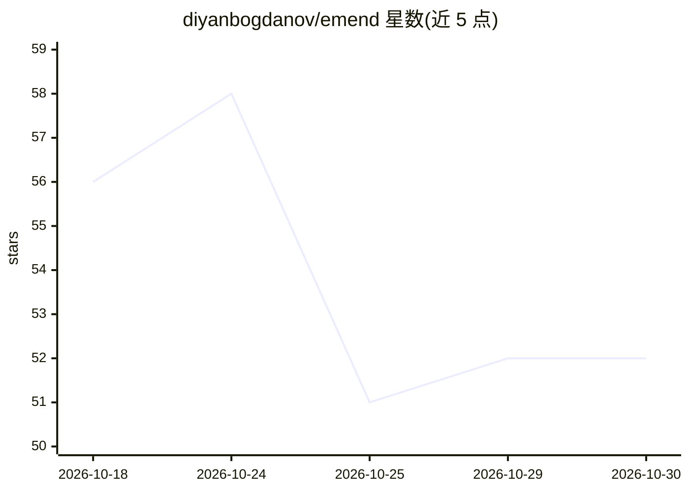

# diyanbogdanov/emend

⭐ 52 · TypeScript · MIT · 推送 2026-10-08 · [GitHub](https://github.com/diyanbogdanov/emend) · [官网](https://www.npmjs.com/package/emend-cli) · 个人维护

**AI 辅助的依赖升级迁移 CLI：定位破坏点、修复并验证编译测试**

面向 TypeScript/npm 与 Python/PyPI 仓库的依赖升级工具：通过 diff 两个版本已发布的 .d.ts 类型声明并与调用点求交集，把海量 breaking changes 缩减为带文件行号的工作清单；迁移由 agent 在一次性 git worktree 中执行，迁移前后各跑一次 typecheck 与测试并比对，区分 verified/regression/pre-existing-failure 等状态。确定性核心（检测、定位、验证）不依赖模型，模型仅在判断环节参与；修复需 opencode 二进制与任意 OpenAI 兼容端点。自述为 MVP，fix 与 PR 仅支持 npm。

## 筛选速览

| 维度 | 判定 | 备注 |
|---|---|---|
| AI 角色 | `ai-ecosystem` | LLM/agent 周边工具 |
| 许可风险 | `permissive` | MIT |
| 部署形态 | `self-host` | docker 或自建部署 |
| 模型依赖 | local-ok | 支持本地模型 |
| 硬件要求 | — | 无带数字的原话,不猜 |
| 安装摩擦 | `low` | 无编译、无系统依赖或容器化 |
| 成熟度 | `idea` | |

## 能力要点

- .d.ts 双版本 diff 与调用点交集定位受影响行
- 迁移在一次性 git worktree 中执行，前后基线对比验证 typecheck 与测试
- 强制诚实规则：unanalyzable/unverified/typecheck-only 不计为成功
- emend mcp 以 MCP 协议暴露七个工具供编码 agent 调用

## 适用场景

- 依赖大版本升级前找出真正影响本仓库代码的 breaking changes
- 让 agent 在隔离 worktree 中完成迁移并验证编译与测试通过
- 检查 lockfile 与 Dockerfile/CI 矩阵/.nvmrc 中的版本漂移
- 以 GitHub App 形式托管监控并自动开出草稿 PR

## 场景标签

`编码 Agent` · 领域:编码与开发

## 证据(README 行号)

> L44: Most tools in this category end at "the model edited your files." Emend treats that as
> L93: The deterministic core — detection, localisation, rename-class migrations, verification —

## 星数曲线

2026-10-18 56 → 2026-10-30 52（-4）

---
*卡片 v1 · prompt 1.4 · 生成 2026-10-24 · 置信度 mid · 依据 README sha `8502ed083e44` · [字段定义](../../DATASET.md)*
