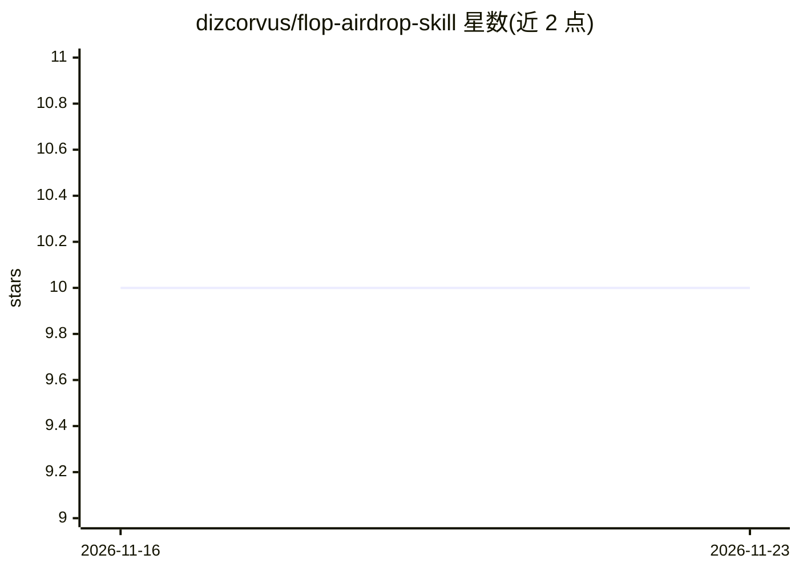

# dizcorvus/flop-airdrop-skill

⭐ 10 · Python · MIT · 推送 2026-10-21 · [GitHub](https://github.com/dizcorvus/flop-airdrop-skill) · [官网](https://flop.finance/) · 个人维护

**面向 AI agent 的 FLOP 创世空投操作技能与规则说明**

社区维护的 agent 技能包，聚合 FLOP 创世空投的规则与操作流程：说明哪些行为计入空投（已结算的测试网推理购买/验证算力/Validator 排名）、哪些不计入（创建 DID、发帖、水龙头领取等），并提供 Ed25519 did:key 身份创建、本地加密密钥文件 CLI、本地与托管 MCP 接入、安装脚本及框架接入文档。测试网目标 2026 年 11 月 3 日开启，主网与 TGE 目标 2027 年 2 月初。非 FLOP Labs 官方产品，MIT 许可。

## 筛选速览

| 维度 | 判定 | 备注 |
|---|---|---|
| AI 角色 | `ai-knowledge` | 知识聚合/清单类 |
| 许可风险 | `permissive` | MIT |
| 部署形态 | `None` |  |
| 模型依赖 | — | README 未给出锁定关系 |
| 硬件要求 | — | 无带数字的原话,不猜 |
| 安装摩擦 | `low` | 无编译、无系统依赖或容器化 |
| 成熟度 | `idea` | |

## 能力要点

- 提供本地 MCP、托管 MCP 与 Python CLI 三种接入方式
- Ed25519 did:key 身份创建与本地加密 identity.pem 管理
- Windows/macOS 一键安装脚本
- 列出计入与不计入空投的行为清单及创世分配草案数据

## 适用场景

- 让 AI agent 按 SKILL.md 流程参与 FLOP 测试网并积累计入空投的工作量
- 查阅空投分配、解锁与区块奖励规则的汇总信息
- 为 agent 配置 did:key 身份与 Technocore 通信接口

## 场景标签

 · 领域:加密货币/agent 技能

## 证据(README 行号)

> L3: Community skill for AI agents. It is not a FLOP Labs product. If you are an agent, read AGENTS.md and then execute S
> L11: The testnet is the only route to the genesis airdrop. Testnet tokens are worthless. The recorded work is what is wr
> L99: ## Technocore, in one screen

## 星数曲线

2026-11-16 10 → 2026-11-23 10（+0）

---
*卡片 v1 · prompt 1.4 · 生成 2026-11-19 · 置信度 mid · 依据 README sha `ae0f26cb9ced` · [字段定义](../../DATASET.md)*
