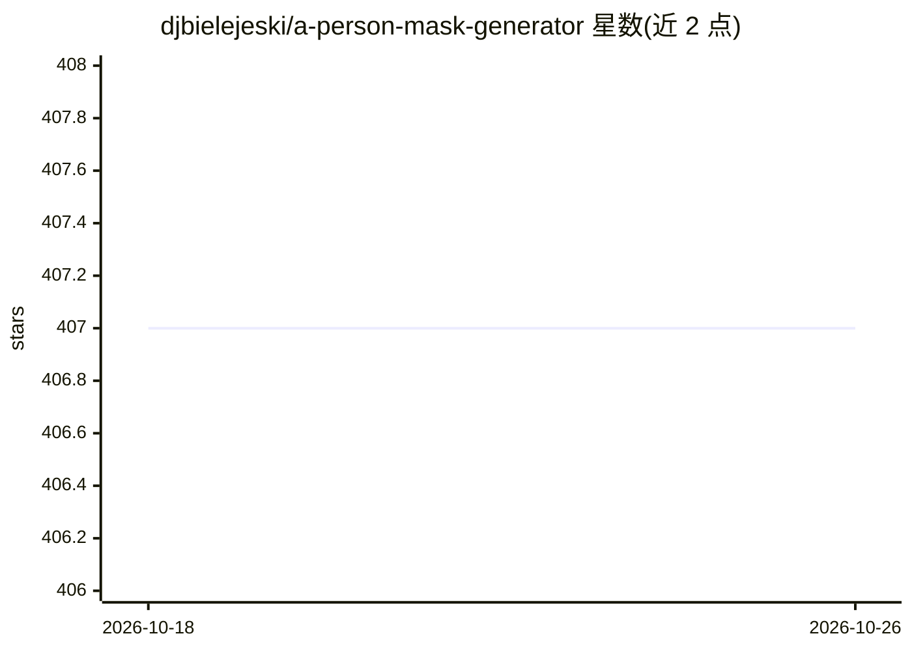

# djbielejeski/a-person-mask-generator

⭐ 407 · Python · MIT · 推送 2026-02-10 · [GitHub](https://github.com/djbielejeski/a-person-mask-generator) · 个人维护

**A1111/ComfyUI 扩展：自动生成人物部位分割掩码供 Img2Img 使用**

同时支持 Automatic1111 与 ComfyUI 的扩展，基于 Google 的多类自拍分割模型（经 MediaPipe 运行），为背景/头发/身体/面部/衣物生成掩码，用于 Img2Img 局部重绘。支持面部关键点掩码输出与掩码二次精化：对检测区域裁剪后再跑一遍检测，改善大分辨率下人物较远时的效果。ComfyUI 通过 git clone 安装到 custom_nodes 并 pip 安装依赖；A1111 通过 Extensions 的 Install from URL 安装。

## 筛选速览

| 维度 | 判定 | 备注 |
|---|---|---|
| AI 角色 | `ai-native` | 本体是模型或模型工具 |
| 许可风险 | `permissive` | MIT |
| 部署形态 | `desktop` | 安装包/桌面程序 |
| 模型依赖 | — | README 未给出锁定关系 |
| 硬件要求 | — | 无带数字的原话,不猜 |
| 安装摩擦 | `low` | 无编译、无系统依赖或容器化 |
| 成熟度 | — | 结构信号不足 |

## 能力要点

- 基于 Google 多类自拍分割模型生成背景/头发/身体/面部/衣物掩码
- 掩码精化：裁剪检测区域后二次检测，适用大分辨率远景人物
- ComfyUI 支持面部关键点掩码输出
- 同时适配 Automatic1111 Web UI 与 ComfyUI

## 适用场景

- 在 Img2Img 中只重绘人物特定部位（如换发型、换衣物）
- 为背景替换生成人物与背景分离掩码
- 在 ComfyUI 工作流中接入人体分割节点

## 场景标签

`图像生成` `目标检测` · 领域:内容生成

## 证据(README 行号)

> L2: Extension for Automatic1111 and ComfyUI to automatically create masks for Background/Hair/Body/Face/Clothes in Img2I
> L4: Uses the Multi-class selfie segmentation model model by Google.

## 星数曲线

2026-10-18 407 → 2026-10-26 407（+0）

---
*卡片 v1 · prompt 1.4 · 生成 2026-10-21 · 置信度 high · 依据 README sha `1bbe37713841` · [字段定义](../../DATASET.md)*
