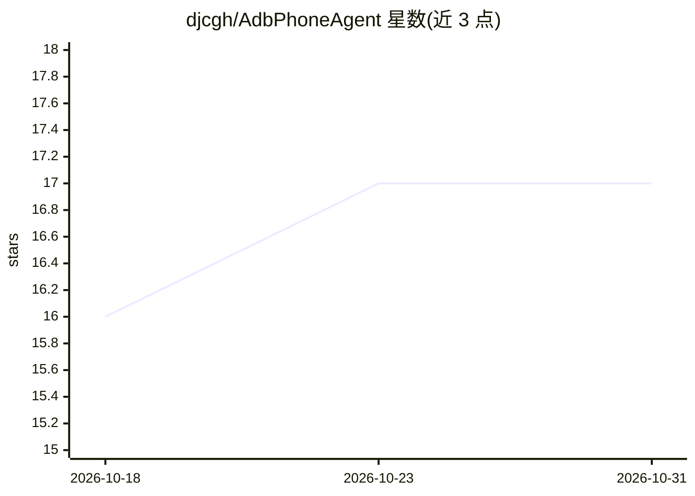

# djcgh/AdbPhoneAgent

⭐ 17 · Python · 推送 2026-03-26 · [GitHub](https://github.com/djcgh/AdbPhoneAgent) · 个人维护 · 中文 README

**用自然语言通过 LLM Agent 操控 Android 手机的工具**

基于 ADB 原生命令与 OpenAI Agents SDK 的手机操控 Agent：优先通过 uiautomator dump 解析界面 XML 结构树定位元素并执行 tap/swipe 等命令，UI 树信息不足时（WebView/Flutter/游戏）才调用视觉模型分析截图作为辅助。内置基于 edge-tts 的中文 TTS 语音播报，面向视障用户；通过 LiteLLM 支持任意 OpenAI 兼容 API（Qwen/DeepSeek/Ollama 等）。需 Python 3.10+ 与已配置的 ADB 环境，含 PC 控制台与手机端 Web 界面。

## 筛选速览

| 维度 | 判定 | 备注 |
|---|---|---|
| AI 角色 | `ai-native` | 本体是模型或模型工具 |
| 许可风险 | `none` | — |
| 部署形态 | `library` | 以包/库形式分发 |
| 模型依赖 | — | README 未给出锁定关系 |
| 硬件要求 | — | 无带数字的原话,不猜 |
| 安装摩擦 | `low` | 无编译、无系统依赖或容器化 |
| 成熟度 | — | 结构信号不足 |

## 能力要点

- UI 结构树优先解析、截图视觉理解为辅助的操控策略
- 基于 OpenAI Agents SDK 的观察-思考-行动循环与 function calling
- edge-tts 中文语音播报，面向视障用户，可开关
- 通过 LiteLLM 接入任意 OpenAI 兼容 API（含本地 Ollama）

## 适用场景

- 用自然语言指令让手机完成打开应用、发消息、调亮度等操作
- 视障用户通过语音播报获知操作过程与结果
- 通过多轮对话连续操控手机并追问之前的操作结果

## 场景标签

`GUI 自动化` `语音合成` · 领域:效率与自动化

## 证据(README 行号)

> L5: 用自然语言控制你的 Android 手机。基于 ADB 原生指令 + LLM Agent，通过 UI 结构树解析实现快速精准的手机操控。支持 TTS 语音播报，面向视障用户提供无障碍使用体验。
> L25: 基于 OpenAI Agents SDK，不是简单的 prompt → action 映射：

## 星数曲线

2026-10-18 16 → 2026-10-31 17（+1）

---
*卡片 v1 · prompt 1.4 · 生成 2026-10-29 · 置信度 mid · 依据 README sha `7783cda8707c` · [字段定义](../../DATASET.md)*
