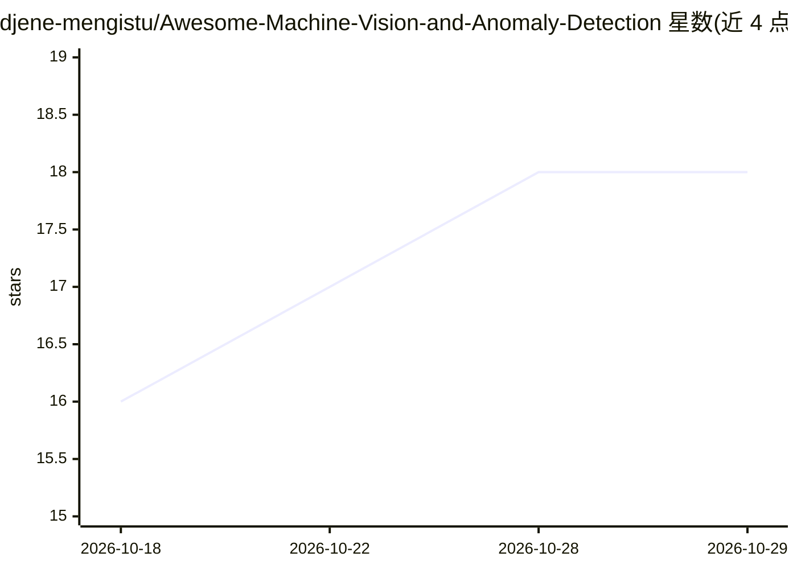

# djene-mengistu/Awesome-Machine-Vision-and-Anomaly-Detection

⭐ 18 · 推送 2026-04-18 · [GitHub](https://github.com/djene-mengistu/Awesome-Machine-Vision-and-Anomaly-Detection) · 个人维护

**工业机器视觉与异常检测的深度学习论文清单**

策展型论文集合：按工业异常检测（表面缺陷检测与定位）、缺陷分类/检测/分割、半监督与弱监督学习三个板块组织，收录 2019-2026 年发表于 CVPR、ICLR、NeurIPS、IEEE 期刊等处的论文，每条注明年份、标题、发表处与代码可用性（多为 Pytorch，部分未公开代码）。README 声明每周更新新论文，另含工业 AI 背景介绍章节。面向从事智能制造质检方向的科研人员与开发者做文献检索用。

## 筛选速览

| 维度 | 判定 | 备注 |
|---|---|---|
| AI 角色 | `ai-knowledge` | 知识聚合/清单类 |
| 许可风险 | `none` | — |
| 部署形态 | `None` |  |
| 模型依赖 | — | README 未给出锁定关系 |
| 硬件要求 | — | 无带数字的原话,不猜 |
| 安装摩擦 | `low` | 无编译、无系统依赖或容器化 |
| 成熟度 | — | 结构信号不足 |

## 能力要点

- 三个板块组织论文：异常检测、分类/检测/分割、半监督/弱监督学习
- 每条目标注年份、发表会议/期刊与代码可用性
- README 声明每周新增论文

## 适用场景

- 查找工业表面缺陷检测与定位的最新论文
- 调研缺陷分割与弱监督学习方法
- 按代码可用性筛选可复现的方法

## 场景标签

`精选清单` · 领域:学习与行业

## 证据(README 行号)

> L3: > *A curated collection of state-of-the-art deep learning papers for industrial machine vision and anomaly detection
> L36: |Year|Title/Source|Journal/Conference|Code|
> L89: |Year|Title/Source|Journal/Conference|Code|

## 星数曲线

2026-10-18 16 → 2026-10-29 18（+2）

---
*卡片 v1 · prompt 1.4 · 生成 2026-10-29 · 置信度 high · 依据 README sha `7a1121ec6500` · [字段定义](../../DATASET.md)*
