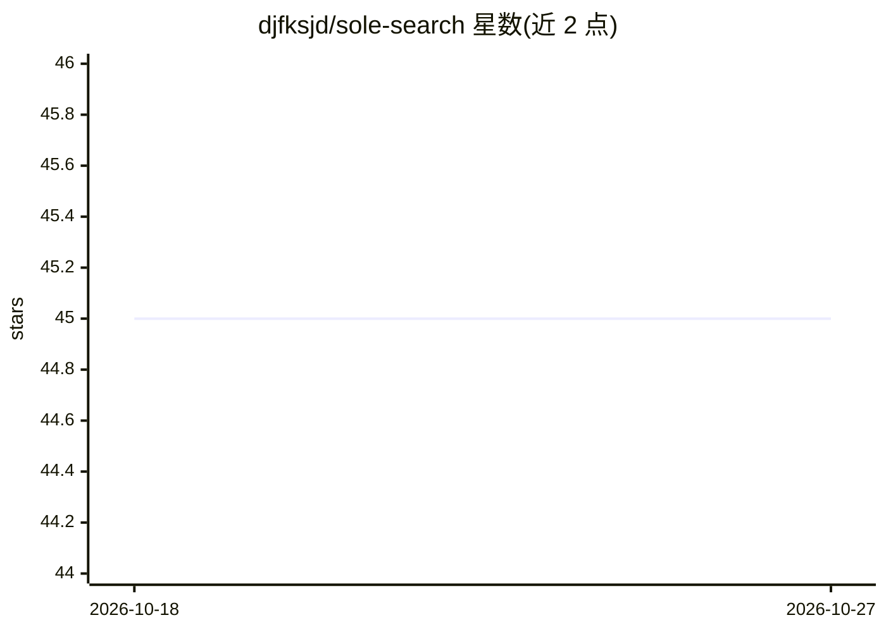

# djfksjd/sole-search

⭐ 45 · Python · MIT · 推送 2026-07-30 · [GitHub](https://github.com/djfksjd/sole-search) · 个人维护

**韩国个体商户查政府扶持项目的 agent 技能：全量爬取公告并按店铺画像判定资格**

面向正在营业的韩国小商户（饭店、咖啡店、美容室、线上卖家等）的 AI agent 技能，安装到 Claude Code、Codex、Antigravity、Cursor、Gemini CLI 等宿主中使用。机制：全量爬取小商户24·企业广场（K-Enterprise Plaza）等官方渠道的招募中公告，通过口语化访谈（6~9 问）生成店铺画像（sole-profile.md），按行业·地区·营业年限·员工数·营收执行 5 阶段资格判定，生成按截止顺序排列的报告；支持 diff 复查模式与 coverage_manifest 覆盖清单。限制：仅限韩国；HWP 附件无法自动解析、标记为“需确认”；不预测入选可能性。爬虫仅用 Python 标准库并强制 0.5 秒延迟，采集基于规则、判定由 LLM 完成。

## 筛选速览

| 维度 | 判定 | 备注 |
|---|---|---|
| AI 角色 | `ai-native` | 本体是模型或模型工具 |
| 许可风险 | `permissive` | MIT |
| 部署形态 | `None` |  |
| 模型依赖 | — | README 未给出锁定关系 |
| 硬件要求 | — | 无带数字的原话,不猜 |
| 安装摩擦 | `low` | 无编译、无系统依赖或容器化 |
| 成熟度 | — | 结构信号不足 |

## 能力要点

- 全量爬取小商户24（约1,700条）·企业广场（约1,400条）招募中公告
- 店铺画像 5 阶段资格判定（确认完毕/有条件/需确认/无法申请/事业转型候选）
- diff 复查模式：仅报告新增·变更·消失的增量项目
- coverage_manifest 必须包含采集/审查条数，未读附件的项目不会标记为“确认完毕”

## 适用场景

- 查找适合我店铺的政府和地方政府的扶持项目
- 确认今天可以申请的项目
- 通过前后对比查看新增或截止日期有变动的扶持项目

## 场景标签

`网页抓取` · 领域:效率与自动化

## 证据(README 行号)

> L3: > 치킨집·카페·미용실·온라인셀러… **이미 장사하고 있는 사장님**을 위한 정부·지자체 지원사업
> L4: > 조사 AI 스킬. 소상공인24·기업마당의 모집중 공고를 전수 수집하고, 가게 프로필(업종·지역·업력·
> L5: > 직원수·매출)로 자격을 판정해 **"오늘 신청할 것"** 부터 마감순으로 보고서를 만든다.
> L242: 판단 로직은 스크립트에 없다 — **수집은 룰베이스, 판정은 LLM.**

## 星数曲线

2026-10-18 45 → 2026-10-27 45（+0）

---
*卡片 v1 · prompt 1.4 · 生成 2026-10-25 · 置信度 high · 依据 README sha `8faf9fd64c02` · [字段定义](../../DATASET.md)*
