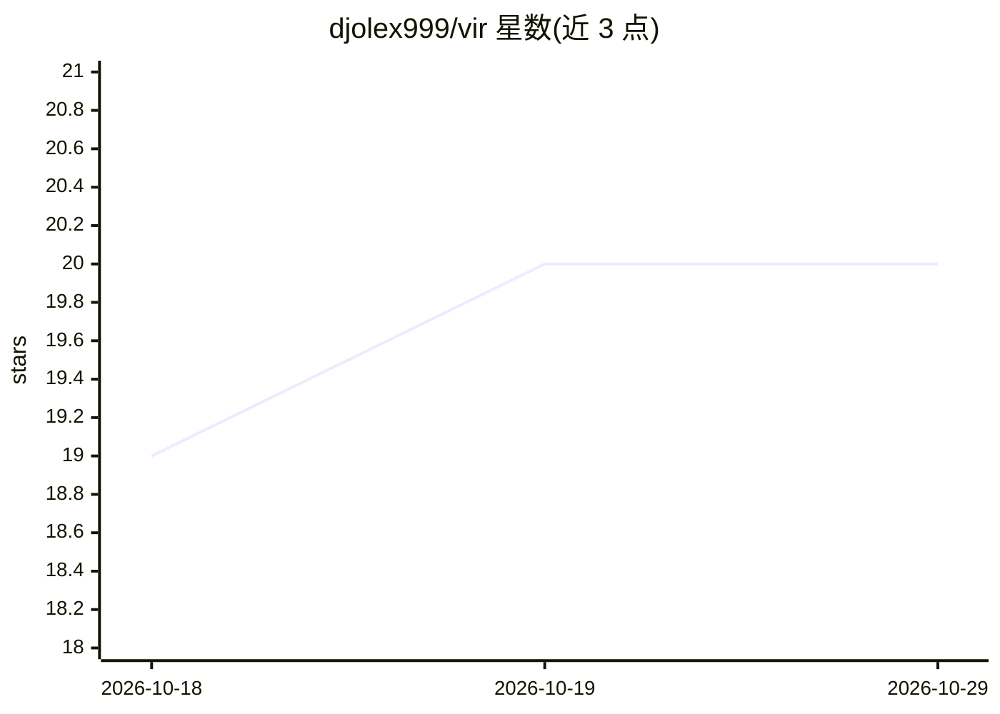

# djolex999/vir

⭐ 20 · TypeScript · MIT · 推送 2026-10-23 · [GitHub](https://github.com/djolex999/vir) · [官网](https://virwiki.dev) · 个人维护

**从 Claude Code/Codex 会话记录蒸馏个人 LLM 知识库的 CLI**

读取本地 Claude Code 与 Codex 会话转录，过滤子代理与工作流噪声，用 Haiku 分类、Sonnet 蒸馏出可留存的知识笔记（patterns/gotchas/decisions/tools），写入用户自有的 markdown 文件夹，Obsidian 原生集成。笔记统一嵌入向量空间（Ollama 可选，TF-IDF 兜底），支持 vir query 问答、MCP server 供 agent 会话中查阅、按条目确认后同步到 CLAUDE.md。内置转录过滤、置信度阈值、lint/dedupe 与成本预估等质量控制。npm 全局安装。

## 筛选速览

| 维度 | 判定 | 备注 |
|---|---|---|
| AI 角色 | `ai-ecosystem` | LLM/agent 周边工具 |
| 许可风险 | `permissive` | MIT |
| 部署形态 | `library` | 以包/库形式分发 |
| 模型依赖 | local-ok | 支持本地模型 |
| 硬件要求 | — | 无带数字的原话,不猜 |
| 安装摩擦 | `low` | 无编译、无系统依赖或容器化 |
| 成熟度 | — | 结构信号不足 |

## 能力要点

- 回溯蒸馏已有 Claude Code/Codex 会话为 typed 笔记（含置信度分数）
- 输出为用户自有的纯 markdown 文件夹，Obsidian 原生（侧边栏插件、wikilink 图谱）
- MCP server 暴露知识库给 Claude Code/Codex，会话中查阅过往决策
- vir connect 从重复出现的教训中提取规则，逐条确认后写入 CLAUDE.md

## 适用场景

- 把数月的 AI 编程会话历史变成可检索的知识库
- 让编码 agent 在会话中通过 MCP 查阅过往决策与教训，避免重复踩坑
- 把反复出现的经验沉淀为规则并同步到 CLAUDE.md/AGENTS.md

## 场景标签

`知识库管理` `Agent 记忆` · 领域:Agent 开发

## 证据(README 行号)

> L88: Vir reads transcripts from `~/.claude/projects`, filters out the noise,
> L89: classifies what survives with Haiku, and distills durable knowledge with
> L100: exposes the vault to Claude Code or Codex mid-session, so the agent consults

## 星数曲线

2026-10-18 19 → 2026-10-29 20（+1）

---
*卡片 v1 · prompt 1.4 · 生成 2026-10-28 · 置信度 high · 依据 README sha `f2ea9aedbd04` · [字段定义](../../DATASET.md)*
