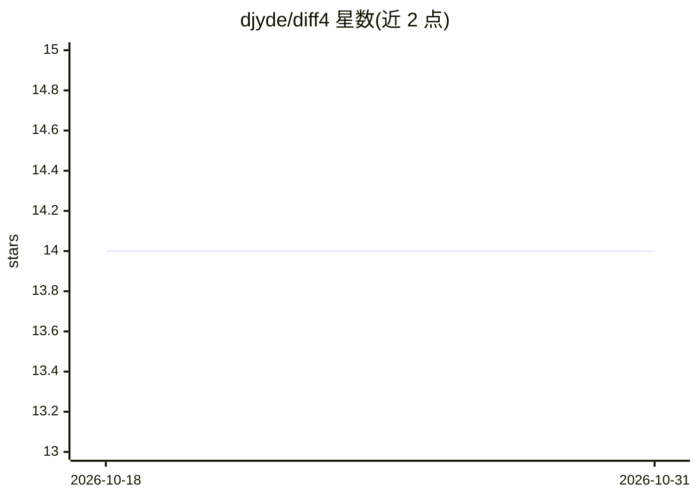

# djyde/diff4

⭐ 14 · TypeScript · 推送 2026-08-10 · [GitHub](https://github.com/djyde/diff4) · [官网](https://diff4.com) · 个人维护

**将 AI 编码 agent 的文件改动加密分享为网页预览的 CLI**

面向使用 AI 编码 agent 的开发者：CLI 在本地用 AES-256-GCM 加密 diff 或文件内容（PBKDF2-SHA256 派生密钥，60 万次迭代），上传后生成 24 小时自动过期的分享链接，服务器仅存密文，接收方需口令解密。提供 git-latest/git-staged/files 三类命令，支持自定义服务器；服务端为 Next.js + PostgreSQL，可用 Docker Compose 一键自部署，或 npx skills 为 agent 安装技能。

## 筛选速览

| 维度 | 判定 | 备注 |
|---|---|---|
| AI 角色 | `ai-ecosystem` | LLM/agent 周边工具 |
| 许可风险 | `none` | — |
| 部署形态 | `self-host` | docker 或自建部署 |
| 模型依赖 | — | README 未给出锁定关系 |
| 硬件要求 | — | 无带数字的原话,不猜 |
| 安装摩擦 | `low` | 无编译、无系统依赖或容器化 |
| 成熟度 | — | 结构信号不足 |

## 能力要点

- 客户端 AES-256-GCM 加密，服务器仅存密文，内容 24 小时过期
- 覆盖最新提交、暂存区与指定文件的加密分享命令
- 支持自建服务器（Docker Compose 或自定义 URL/环境变量）
- 可通过 npx skills 为 OpenClaw 等 agent 安装技能

## 适用场景

- 把 AI agent 生成的代码改动加密分享给同事审阅
- 自部署 diff 分享服务避免代码经第三方明文传输
- 在 PR 之外快速预览 agent 的文件变更渲染页面

## 场景标签

 · 领域:开发工具/代码审查

## 证据(README 行号)

> L3: Beautiful file previews for AI coding agents. Turn your AI agent's file changes into shareable, beautifully rendered
> L15: Copy this prompt to your agent (OpenClaw, Hermes Agent, etc)
> L28: npx skills add djyde/diff4

## 星数曲线

2026-10-18 14 → 2026-10-31 14（+0）

---
*卡片 v1 · prompt 1.4 · 生成 2026-10-31 · 置信度 high · 依据 README sha `864fd1522094` · [字段定义](../../DATASET.md)*
