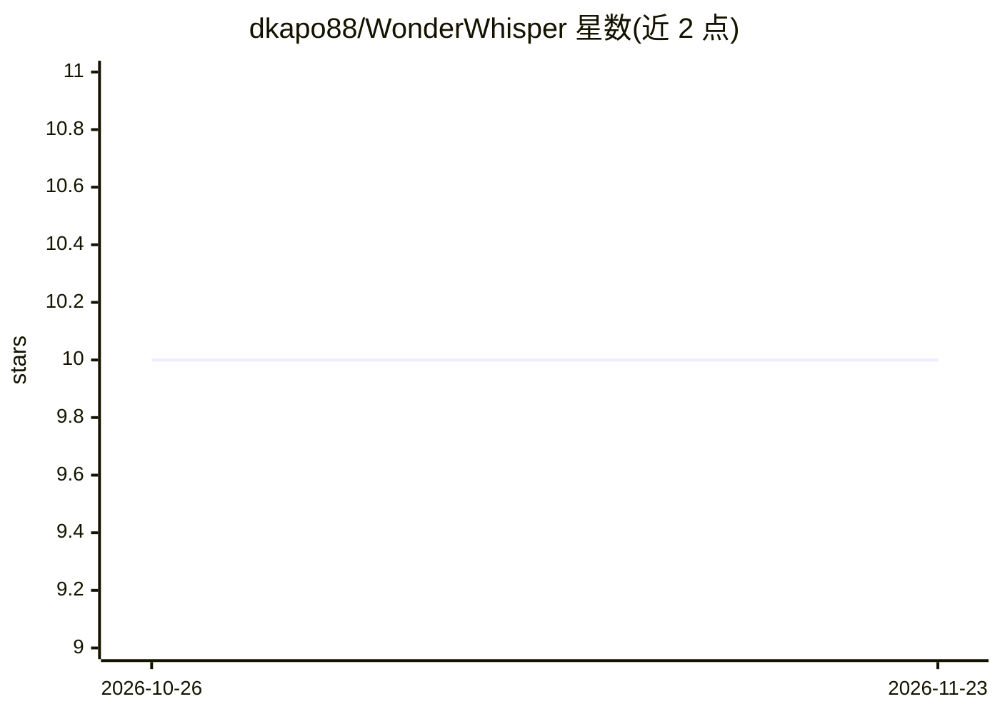

# dkapo88/WonderWhisper

⭐ 10 · Kotlin · MIT · 推送 2026-05-02 · [GitHub](https://github.com/dkapo88/WonderWhisper) · 个人维护

**安卓系统级语音听写应用：录音转文字并插入任意输入框**

开源 Android 听写应用，提供全局悬浮按钮，通过无障碍服务检测输入框并插入转写文本。支持流式与非流式语音转写（Groq、OpenAI、Gemini 等多家服务商），转写后可做 AI 清洗与后处理；Command Mode 可对选中文本改写、回答问题或做文本变换，另支持自定义词汇替换。不带内置 API key，用户自行配置并本地加密存储；需从源码用 Android Studio 构建，无预编译安装包。

## 筛选速览

| 维度 | 判定 | 备注 |
|---|---|---|
| AI 角色 | `ai-native` | 本体是模型或模型工具 |
| 许可风险 | `permissive` | MIT |
| 部署形态 | `None` |  |
| 模型依赖 | locked-api |  |
| 硬件要求 | — | 无带数字的原话,不猜 |
| 安装摩擦 | `low` | 无编译、无系统依赖或容器化 |
| 成熟度 | — | 结构信号不足 |

## 能力要点

- 系统级悬浮听写按钮，通过无障碍服务向任意输入框插入文本
- 多家云端转写服务商接入与流式/非流式转写流程
- 转写后 AI 清洗与 Command Mode 文本变换
- API key 本地加密存储（AndroidX Security Crypto）

## 适用场景

- 在聊天、邮件、浏览器等应用里用语音代替打字
- 口述后让 AI 自动清洗并格式化文字
- 对复制或选中的文本发起改写或提问

## 场景标签

`语音识别` · 领域:感知与多模态

## 证据(README 行号)

> L5: WonderWhisper is an Android dictation app that brings a floating voice-to-text button to any text field. It combines
> L77: 4. The selected transcription provider converts speech to text.

## 星数曲线

2026-10-26 10 → 2026-11-23 10（+0）

---
*卡片 v1 · prompt 1.4 · 生成 2026-11-20 · 置信度 high · 依据 README sha `9f018a57722b` · [字段定义](../../DATASET.md)*
