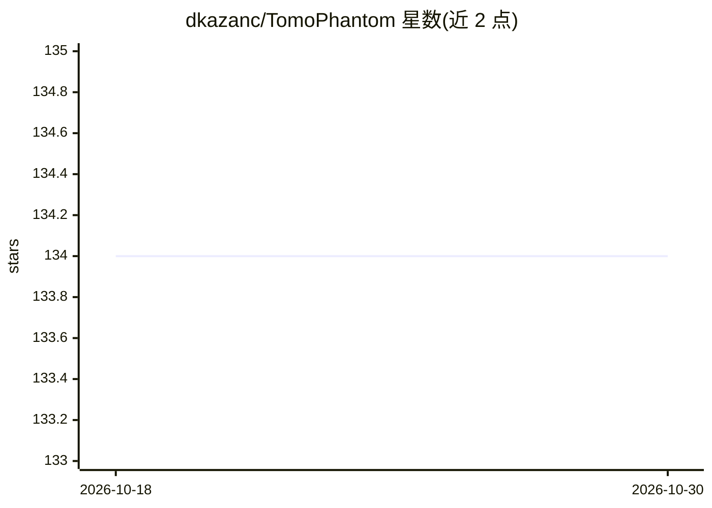

# dkazanc/TomoPhantom

⭐ 134 · Python · Apache-2.0 · 推送 2026-09-14 · [GitHub](https://github.com/dkazanc/TomoPhantom) · [官网](https://dkazanc.github.io/TomoPhantom/) · 个人维护

**生成 2D-4D 解析体模及其 Radon 变换的 CT 重建测试工具箱**

面向断层成像与图像处理研究者的 Python（含 MATLAB 关联）工具箱：以模块化方式构建由 Gaussians、抛物线、椭圆、锥体、矩形等组成的分段常数/分段平滑/平滑解析体模（2D-4D，含时间维度），并计算其解析 Radon 变换与数值投影，可建模噪声、zingers、环状伪影等多种层析数据伪影。用于测试图像重建、去噪、去模糊、分割及机器/深度学习方法。以 conda 包形式分发（Linux/Windows），条目引用 2018 年 Software X 论文。限制：投影数据仅针对平行束几何。

## 筛选速览

| 维度 | 判定 | 备注 |
|---|---|---|
| AI 角色 | `ai-enhanced` | 去掉 AI 部分产品仍成立 |
| 许可风险 | `permissive` | Apache-2.0 |
| 部署形态 | `None` |  |
| 模型依赖 | — | README 未给出锁定关系 |
| 硬件要求 | — | 无带数字的原话,不猜 |
| 安装摩擦 | `low` | 无编译、无系统依赖或容器化 |
| 成熟度 | — | 结构信号不足 |

## 能力要点

- 由解析对象（Gaussians/椭圆/锥体/矩形等）模块化构建 2D-4D 体模
- 计算解析 Radon 变换与数值投影（平行束）
- 建模多种层析数据伪影（噪声模型、zingers、环、偏移、部分容积效应等）
- 提供 2D/3D 体模的时间维度扩展

## 适用场景

- 为 CT 图像重建算法生成可解析的测试数据基准
- 为去噪、去模糊、分割等图像处理方法做数值测试
- 生成带可控伪影的投影数据评估重建鲁棒性

## 场景标签

 · 领域:科学计算/医学与工业成像

## 证据(README 行号)

> L1: TomoPhantom [1] is a toolbox to generate customisable 2D-4D phantoms (with a temporal capability) and their analytic
> L8:  TomoPhantom is recommended for various image processing tasks that require extensive numerical testing: image recon

## 星数曲线

2026-10-18 134 → 2026-10-30 134（+0）

---
*卡片 v1 · prompt 1.4 · 生成 2026-10-22 · 置信度 high · 依据 README sha `554ff1b304ee` · [字段定义](../../DATASET.md)*
