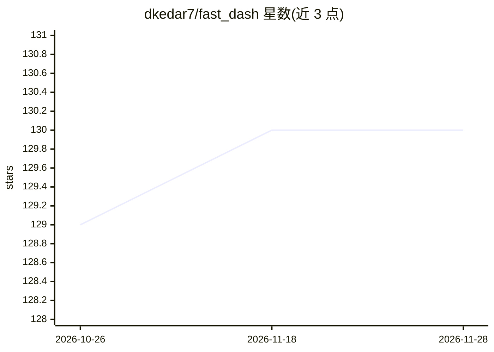

# dkedar7/fast_dash

⭐ 130 · Python · MIT · 推送 2026-11-27 · [GitHub](https://github.com/dkedar7/fast_dash) · [官网](https://docs.fastdash.app) · 个人维护

**给开发者：把 Python 函数一键变成可交互 Web 应用**

一个 Python 库，通过 @fastdash 装饰器读取函数签名，按类型提示与默认值自动选择 UI 组件，并构建为 Plotly Dash 应用（通常五行以内代码），无前端与回调样板。支持流式聊天应用（chat=True，不内置任何 LLM 提供方，由用户自选）、AI agent 经 MCP 接口检查并驱动应用、多函数标签页、steps 多步向导、mosaic 布局、级联输入等模式。经 PyPI 安装，MIT 许可，文档在 docs.fastdash.app；多函数与 steps 模式不支持 MCP 面，MCP 路由无鉴权。

## 筛选速览

| 维度 | 判定 | 备注 |
|---|---|---|
| AI 角色 | `ai-enhanced` | 去掉 AI 部分产品仍成立 |
| 许可风险 | `permissive` | MIT |
| 部署形态 | `library` | 以包/库形式分发 |
| 模型依赖 | — | README 未给出锁定关系 |
| 硬件要求 | — | 无带数字的原话,不猜 |
| 安装摩擦 | `low` | 无编译、无系统依赖或容器化 |
| 成熟度 | — | 结构信号不足 |

## 能力要点

- 函数签名+类型提示自动映射为输入/输出组件
- chat=True 生成流式聊天应用，LLM 提供方由用户自选
- mcp_server=True 使应用同时提供 MCP 服务，agent 可读取输入、调用并生成表单
- 内置 Text/Slider/Upload/Graph/Chat/Download 等组件库

## 适用场景

- 把已有 Python 函数快速发布成可分享的 Web 界面
- 为自己的 LLM 搭建带历史与侧栏参数的聊天界面
- 让 Claude Code/Cursor 等 agent 通过 MCP 操作本地应用
- 将多函数或多步骤流程组织为标签页/向导式工具

## 场景标签

`聊天机器人` · 领域:对话与助手

## 证据(README 行号)

> L31: Fast Dash inspects your Python function's signature, picks UI components from the type hints and default values, an
> L260: Pass `mcp_server=True` and your app serves a web UI **and** an MCP server — built on Dash's native MCP (Dash ≥ 4.3

## 星数曲线

2026-10-26 129 → 2026-11-28 130（+1）

---
*卡片 v1 · prompt 1.4 · 生成 2026-11-28 · 置信度 high · 依据 README sha `66c09d36f634` · [字段定义](../../DATASET.md)*
