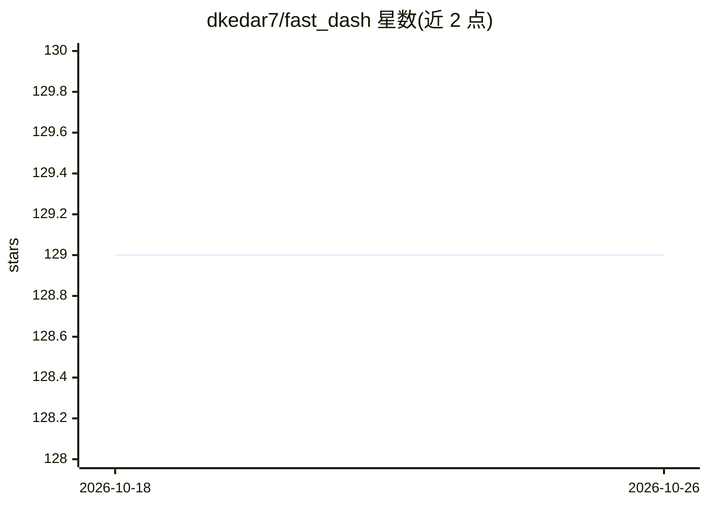

# dkedar7/fast_dash

⭐ 129 · Python · MIT · 推送 2026-10-24 · [GitHub](https://github.com/dkedar7/fast_dash) · [官网](https://docs.fastdash.app) · 个人维护

**把 Python 函数一键变成交互式 Web 应用的装饰器框架**

基于 Plotly Dash 的 Python 框架：@fastdash 装饰器在导入时检查函数签名，按类型注解和默认值自动选取 UI 组件（int→数字输入、DataFrame→表格、PIL.Image→图片上传等），把函数体接为回调并启动服务器，通常少于五行代码生成可分享的 Web 应用。支持聊天模式、Mosaic 布局、多函数标签页、多步骤向导；可选开启 MCP 服务器让 Claude Code/Cursor 等 AI agent 读写并驱动应用。限制：MCP 路由无鉴权，仅建议本机开发使用；多函数与 steps 模式不提供 MCP 接口。

## 筛选速览

| 维度 | 判定 | 备注 |
|---|---|---|
| AI 角色 | `ai-enhanced` | 去掉 AI 部分产品仍成立 |
| 许可风险 | `permissive` | MIT |
| 部署形态 | `library` | 以包/库形式分发 |
| 模型依赖 | — | README 未给出锁定关系 |
| 硬件要求 | — | 无带数字的原话,不猜 |
| 安装摩擦 | `low` | 无编译、无系统依赖或容器化 |
| 成熟度 | — | 结构信号不足 |

## 能力要点

- 装饰器按类型注解自动生成输入/输出 UI 组件
- chat=True 可将回调变为流式聊天应用，LLM 提供方由用户自选
- mcp_server=True 同端口提供 MCP 服务，AI agent 可发现并驱动应用
- 内置 20 余种组件，支持 Mosaic 布局、级联输入、多步骤流水线

## 适用场景

- 把数据分析或机器学习函数快速发布为可分享的 Web 应用
- 为 Python 函数生成带聊天界面的 LLM 应用原型
- 让 Claude Code/Cursor 等 agent 通过 MCP 直接操控自己构建的应用

## 场景标签

 · 领域:Web 应用框架/数据科学工具

## 证据(README 行号)

> L3:  Turn any Python function into a web app with a single decorator ⚡
> L31: Fast Dash inspects your Python function's signature, picks UI components from the type hints and default values, an
> L257: Pass `mcp_server=True` and your app serves a web UI **and** an MCP server — built on Dash's native MCP (Dash ≥ 4.3

## 星数曲线

2026-10-18 129 → 2026-10-26 129（+0）

---
*卡片 v1 · prompt 1.4 · 生成 2026-10-22 · 置信度 high · 依据 README sha `d86196933eed` · [字段定义](../../DATASET.md)*
