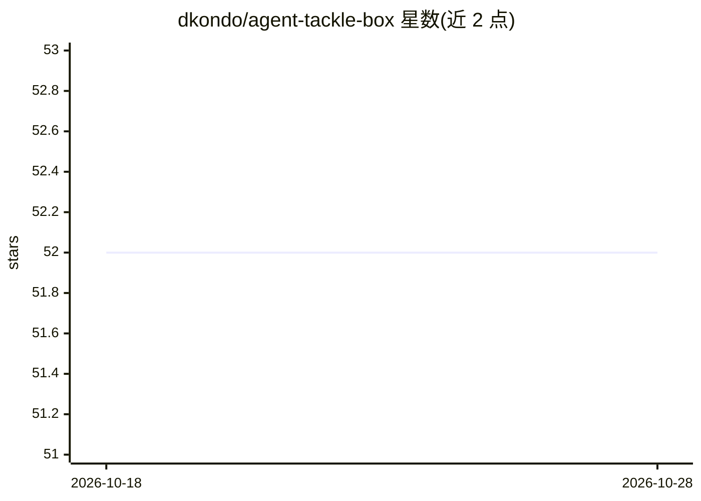

# dkondo/agent-tackle-box

⭐ 52 · Python · MIT · 推送 2026-05-11 · [GitHub](https://github.com/dkondo/agent-tackle-box) · [官网](https://github.com/dkondo/agent-tackle-box) · 个人维护

**AI agent 开发工具箱，含 LangGraph/LangChain agent 终端调试器**

agent 开发工具集，当前包含 agent-debugger：一个基于 Textual 的终端调试器，面向 LangGraph 与 LangChain 构建的 agent。将 agent 层调试（状态、消息、工具调用、store 快照、语义断点）与 Python 层调试（行断点、单步、调用栈、局部变量）合并于同一界面。以 Python 工具形式提供，详细用法见子项目 README。当前 README 仅为主入口，细节文档位于 projects/agent-debugger/README.md。

## 筛选速览

| 维度 | 判定 | 备注 |
|---|---|---|
| AI 角色 | `ai-ecosystem` | LLM/agent 周边工具 |
| 许可风险 | `permissive` | MIT |
| 部署形态 | `None` |  |
| 模型依赖 | — | README 未给出锁定关系 |
| 硬件要求 | — | 无带数字的原话,不猜 |
| 安装摩擦 | `low` | 无编译、无系统依赖或容器化 |
| 成熟度 | — | 结构信号不足 |

## 能力要点

- LangGraph/LangChain agent 的终端调试器（Textual UI）
- agent 层与 Python 层调试合并于同一界面
- 支持状态检查、工具调用查看、store 快照与语义断点

## 适用场景

- 调试 LangGraph/LangChain agent 的状态流转与工具调用
- 在 agent 执行中设置语义断点定位问题
- agent 运行时同时进行 Python 代码级单步调试

## 场景标签

`LLM 可观测性` · 领域:评测与运维

## 证据(README 行号)

> L2: A toolkit for developing AI agents.
> L5: `agent-debugger` is a terminal debugger for LangGraph/LangChain agents. It combines agent-level visibility (state, m

## 星数曲线

2026-10-18 52 → 2026-10-28 52（+0）

---
*卡片 v1 · prompt 1.4 · 生成 2026-10-24 · 置信度 mid · 依据 README sha `8291952126d2` · [字段定义](../../DATASET.md)*
