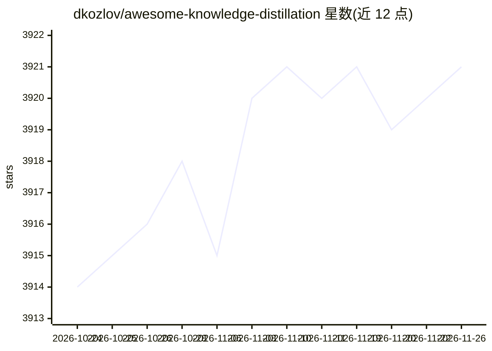

# dkozlov/awesome-knowledge-distillation

⭐ 3,921 · Apache-2.0 · 推送 2026-11-22 · [GitHub](https://github.com/dkozlov/awesome-knowledge-distillation) · 个人维护

**知识蒸馏与模型压缩领域的论文清单**

以列表形式收录知识蒸馏（knowledge distillation）方向的论文条目，时间跨度从 1990 年的神经网络集成工作到 2019 年的 DistilBERT 等成果，涵盖模型压缩、师生网络、自蒸馏、互学习、协同训练与半监督学习等主题，条目按年份排列并附作者与会议信息（NIPS/ICML/CVPR/ICCV/EMNLP 等）。README 仅含论文列表，不提供代码或安装说明，适合需要查找该领域文献的读者作为索引使用。

## 筛选速览

| 维度 | 判定 | 备注 |
|---|---|---|
| AI 角色 | `ai-knowledge` | 知识聚合/清单类 |
| 许可风险 | `permissive` | Apache-2.0 |
| 部署形态 | `None` |  |
| 模型依赖 | — | README 未给出锁定关系 |
| 硬件要求 | — | 无带数字的原话,不猜 |
| 安装摩擦 | `low` | 无编译、无系统依赖或容器化 |
| 成熟度 | — | 结构信号不足 |

## 能力要点

- 按时间顺序收录 1990–2019 年知识蒸馏相关论文
- 覆盖模型压缩、自蒸馏、互学习、协同训练等子主题
- 条目附作者与发表会议信息

## 适用场景

- 查找知识蒸馏领域的经典与代表性论文
- 做模型压缩方向文献调研时作为起点索引
- 了解师生网络训练方法的演化脉络

## 场景标签

`科研工具` `精选清单` · 领域:学习与行业

## 证据(README 行号)

> L1: Awesome Knowledge Distillation
> L3: Papers

## 星数曲线

2026-10-24 3,914 → 2026-11-26 3,921（+7）

---
*卡片 v1 · prompt 1.4 · 生成 2026-11-23 · 置信度 high · 依据 README sha `331cfc57fed9` · [字段定义](../../DATASET.md)*
