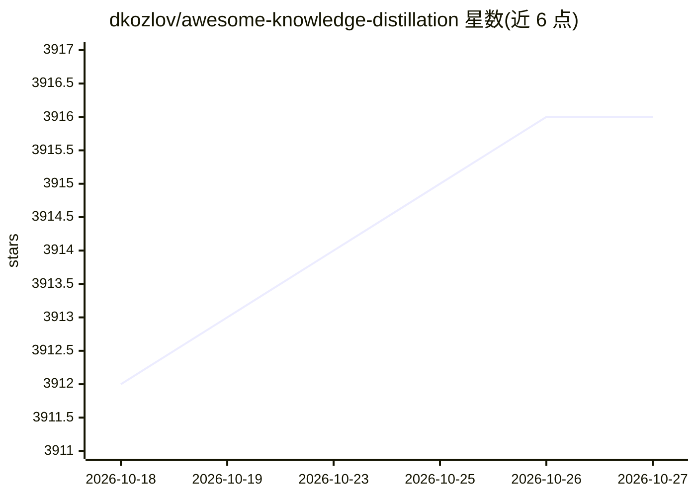

# dkozlov/awesome-knowledge-distillation

⭐ 3,916 · Apache-2.0 · 推送 2026-10-26 · [GitHub](https://github.com/dkozlov/awesome-knowledge-distillation) · 个人维护

**知识蒸馏论文清单：收录 1990-2019 相关研究文献**

由个人维护的知识蒸馏（Knowledge Distillation）领域论文聚合清单，按时间顺序收录 1990 年至 2019 年约 90 篇论文条目，每条含标题、作者与发表年份/会议信息，覆盖模型压缩、教师-学生网络、自蒸馏、数据无关蒸馏、语义分割/目标检测/NLP 中的蒸馏应用等方向。内容为纯文献列表，不提供代码、安装方式或工具。面向从事模型压缩与知识迁移研究的人员用于文献检索。

## 筛选速览

| 维度 | 判定 | 备注 |
|---|---|---|
| AI 角色 | `ai-knowledge` | 知识聚合/清单类 |
| 许可风险 | `permissive` | Apache-2.0 |
| 部署形态 | `None` |  |
| 模型依赖 | — | README 未给出锁定关系 |
| 硬件要求 | — | 无带数字的原话,不猜 |
| 安装摩擦 | `low` | 无编译、无系统依赖或容器化 |
| 成熟度 | — | 结构信号不足 |

## 能力要点

- 按年份组织的约 90 篇知识蒸馏论文条目
- 覆盖 1990-2019 年，从早期集成方法到 DistilBERT 等
- 每条含标题、作者与发表会议信息

## 适用场景

- 查找知识蒸馏方向的经典与前沿论文
- 梳理模型压缩与教师-学生训练方法的研究脉络

## 场景标签

`精选清单` · 领域:学习与行业

## 证据(README 行号)

> L1: Awesome Knowledge Distillation
> L3: Papers

## 星数曲线

2026-10-18 3,912 → 2026-10-27 3,916（+4）

---
*卡片 v1 · prompt 1.4 · 生成 2026-10-20 · 置信度 high · 依据 README sha `90f2c6ff9a91` · [字段定义](../../DATASET.md)*
