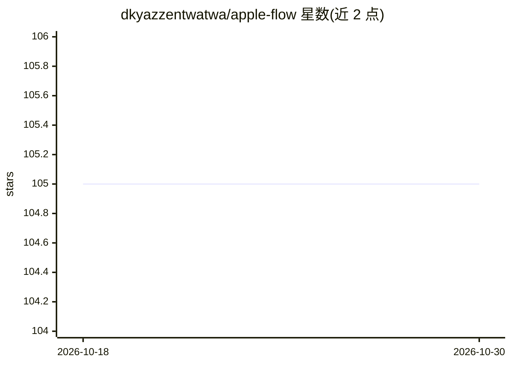

# dkyazzentwatwa/apple-flow

⭐ 105 · Python · MIT · 推送 2026-03-30 · [GitHub](https://github.com/dkyazzentwatwa/apple-flow) · [官网](https://apple-flow-site.vercel.app/) · 个人维护 · 中文 README

**通过 iMessage/Mail 等 Apple 应用驱动 AI CLI 的 macOS 守护进程**

本地优先的 macOS 守护进程，将 iMessage、Mail、Reminders、Notes、Calendar 等应用作为 AI CLI（Codex、Claude、Gemini、Cline、Kilo、Ollama）的操作通道，用户通过消息发送自然语言指令触发聊天、计划与变更任务。默认启用发送者白名单、变更任务审批门与工作区限制等安全机制；支持附件解析（含本地 Whisper 语音转录）、语音回复、记忆与审计日志（SQLite+CSV），并附 Swift 引导/仪表盘应用。可选网关默认全部关闭，需逐项启用。

## 筛选速览

| 维度 | 判定 | 备注 |
|---|---|---|
| AI 角色 | `ai-ecosystem` | LLM/agent 周边工具 |
| 许可风险 | `permissive` | MIT |
| 部署形态 | `library` | 以包/库形式分发 |
| 模型依赖 | local-ok | 支持本地模型 |
| 硬件要求 | — | 无带数字的原话,不猜 |
| 安装摩擦 | `low` | 无编译、无系统依赖或容器化 |
| 成熟度 | — | 结构信号不足 |

## 能力要点

- 五类 Apple 应用网关 + 多 AI CLI 连接器（含 Ollama 原生 HTTP 连接）
- 发送者白名单、审批门、工作区限制等默认安全机制
- 附件上下文解析：文本/PDF/OCR 图片/Office/Whisper 语音转录
- SQLite 规范审计存储 + CSV 分析镜像，附浏览器仪表盘与 Swift 本地应用

## 适用场景

- 在手机上通过 iMessage 让 AI 代为执行本机任务
- 以审批门控制 AI 的变更操作，保留审计日志
- 用 Mail/Reminders/Notes/Calendar 作为 AI 任务触发入口

## 场景标签

`AI 助手` · 领域:对话与助手

## 证据(README 行号)

> L26: Apple Flow is a local-first macOS daemon that bridges Apple apps to AI CLIs (Codex, Claude, Gemini, Cline, and Kilo
> L348: ## AI Backends

## 星数曲线

2026-10-18 105 → 2026-10-30 105（+0）

---
*卡片 v1 · prompt 1.4 · 生成 2026-10-23 · 置信度 mid · 依据 README sha `da650d516bb2` · [字段定义](../../DATASET.md)*
