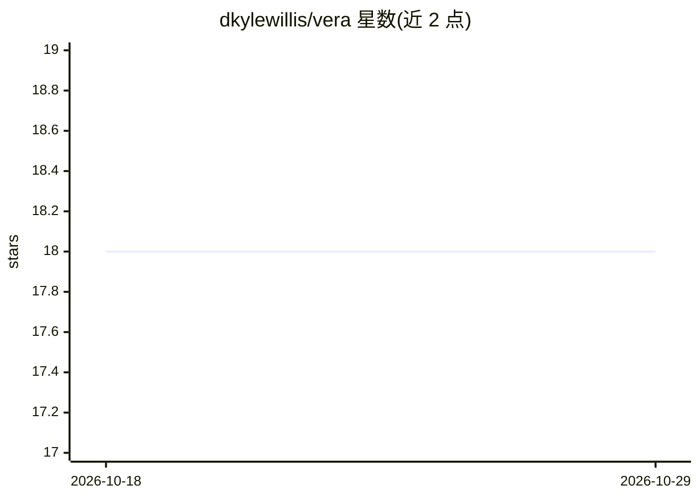

# dkylewillis/vera

⭐ 18 · Python · Apache-2.0 · 推送 2026-10-27 · [GitHub](https://github.com/dkylewillis/vera) · 个人维护

**把文档转成可搜索 .vera 文件的本地检索归档工具**

将 PDF/Markdown 转换为自包含的 .vera SQLite 归档，内含文本、嵌入向量、关键词索引与引用信息，无需数据库服务器即可复制分享。提供 CLI、Python 包、MCP 服务与 Windows 桌面应用；支持 keyword/semantic/hybrid 三种检索模式，默认 hashing 嵌入器离线可用且无需 API key，也可接入 sentence-transformers 本地模型、OpenAI 嵌入或自定义插件。面向需要为 AI agent 或本地检索提供结构化证据（引用、页码、JSON 输出）的开发者与文档管理者。软件版本 0.3.x，声明为实验性 pre-1.0。

## 筛选速览

| 维度 | 判定 | 备注 |
|---|---|---|
| AI 角色 | `ai-ecosystem` | LLM/agent 周边工具 |
| 许可风险 | `permissive` | Apache-2.0 |
| 部署形态 | `library` | 以包/库形式分发 |
| 模型依赖 | — | README 未给出锁定关系 |
| 硬件要求 | — | 无带数字的原话,不猜 |
| 安装摩擦 | `low` | 无编译、无系统依赖或容器化 |
| 成熟度 | `idea` | |

## 能力要点

- 单一 .vera SQLite 文件包含文本、嵌入、关键词索引与引用
- keyword/semantic/hybrid 三种检索模式，默认离线 hashing 嵌入器
- 可接入 sentence-transformers 本地模型、OpenAI 嵌入或自定义嵌入插件
- 提供 CLI、MCP 服务、Agent Skill、Codex 插件与 Windows 桌面应用

## 适用场景

- 把 PDF 手册或文档库转成本地可搜索归档，离线检索
- 为 AI agent 提供带引用与页码的结构化检索证据（MCP/CLI/JSON）
- 按元数据过滤后在文档库中做关键词或语义检索

## 场景标签

`语义搜索` · 领域:知识与检索

## 证据(README 行号)

> L9: VERA turns documents into searchable `.vera` files. Each file holds the text,
> L198: - **CLI:** any agent that can run shell commands can use VERA.
> L199: - **MCP:** install `vera[mcp]` and run `vera mcp`. Search with `output: "compact"`

## 星数曲线

2026-10-18 18 → 2026-10-29 18（+0）

---
*卡片 v1 · prompt 1.4 · 生成 2026-10-29 · 置信度 high · 依据 README sha `b5a1a476be93` · [字段定义](../../DATASET.md)*
