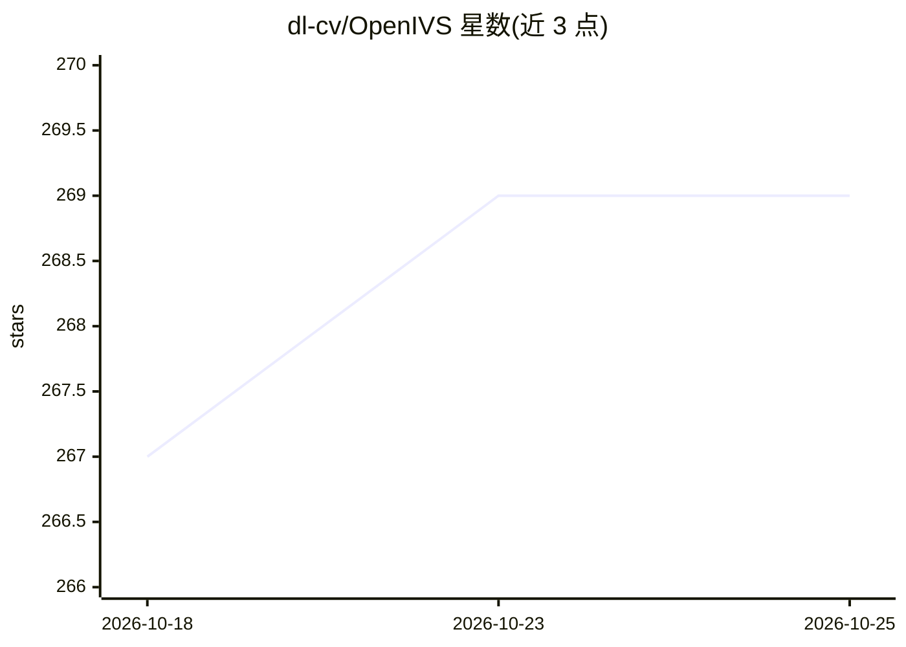

# dl-cv/OpenIVS

⭐ 269 · C# · Apache-2.0 · 推送 2026-10-24 · [GitHub](https://github.com/dl-cv/OpenIVS) · [官网](https://dlcv.com.cn) · 组织维护 · 中文 README

**给工业自动化开发者的 .NET 开源工业视觉检测框架**

基于 .NET/WPF 的开源工业视觉软件框架，覆盖相机连接与图像采集（海康 MVS）、图像处理（可选 Halcon 接口）、AI 模型推理（需深度视觉 AI 平台训练模型并安装其高性能 SDK）以及基于 Modbus 的 PLC 控制与位置序列编排。面向需要搭建自动化检测、缺陷识别产线系统的开发者；主流程（移动-拍照-推理）与相机、模型、控制逻辑均以源码形式供修改扩展。未提供成品安装包，需自行安装海康 MVS 与深度视觉 SDK 等依赖后从源码构建。

## 筛选速览

| 维度 | 判定 | 备注 |
|---|---|---|
| AI 角色 | `ai-native` | 本体是模型或模型工具 |
| 许可风险 | `permissive` | Apache-2.0 |
| 部署形态 | `desktop` | 安装包/桌面程序 |
| 模型依赖 | — | README 未给出锁定关系 |
| 硬件要求 | — | 无带数字的原话,不猜 |
| 安装摩擦 | `medium` | 含编译或系统依赖之一 |
| 成熟度 | — | 结构信号不足 |

## 能力要点

- 相机采集、图像处理、模型推理、Modbus PLC 控制一体化
- 支持多模型加载与级联推理（ModelManager 可扩展）
- 位置序列与主流程（移动-拍照-推理）可在源码中自定义
- 兼容海康 MVS 相机 SDK，可选 Halcon 图像处理接口

## 适用场景

- 搭建工业产线的自动化视觉检测/缺陷识别系统
- 通过 Modbus 控制 PLC 实现检测与 OK/NG 信号联动
- 在现有框架上扩展多相机、多模型级联推理方案

## 场景标签

`目标检测` `图像视频处理` · 领域:感知与多模态

## 证据(README 行号)

> L9: OpenIVS 是一个基于 .NET 平台的工业视觉软件框架，提供了相机连接、图像采集、图像处理、模型推理、PLC控制等功能。你可以使用 OpenIVS 快速搭建一个工业视觉检测系统，实现自动化检测、缺陷识别等功能。
> L39:  - 需要安装**高性能SDK套件**才能加载模型进行推理

## 星数曲线

2026-10-18 267 → 2026-10-25 269（+2）

---
*卡片 v1 · prompt 1.4 · 生成 2026-10-22 · 置信度 high · 依据 README sha `6fda52cf9b86` · [字段定义](../../DATASET.md)*
