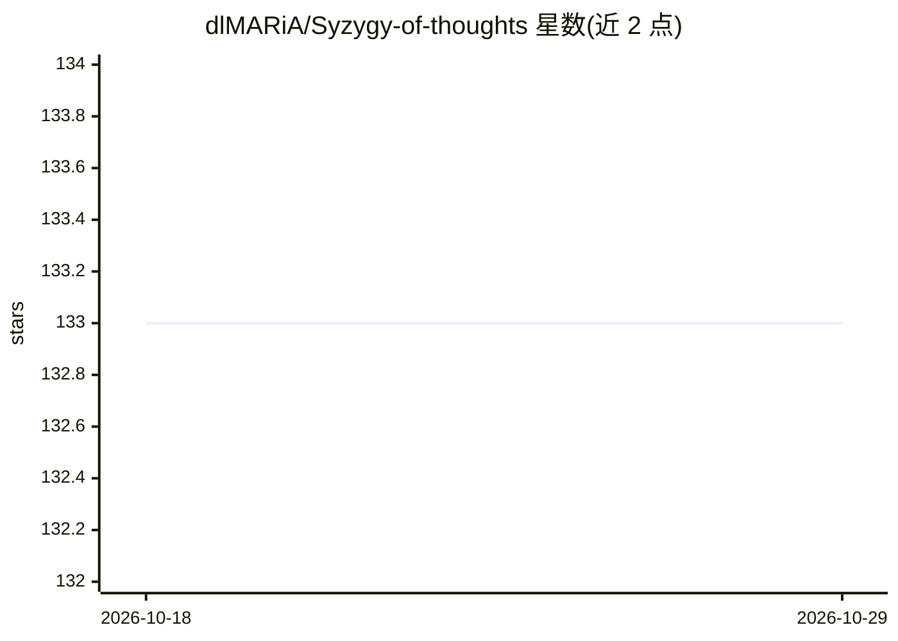

# dlMARiA/Syzygy-of-thoughts

⭐ 133 · Python · MIT · 推送 2026-01-07 · [GitHub](https://github.com/dlMARiA/Syzygy-of-thoughts) · [官网](https://arxiv.org/abs/2504.09566) · 组织维护 · 中文 README

**论文配套代码：基于极小自由分解改进 LLM 思维链推理的 SoT 框架**

论文《Syzygy of Thoughts: Improving LLM Reasoning with Minimal Free Resolution》的官方实现：将交换代数/同调代数中的极小自由分解（MFR）原理引入 Chain of Thought，构成 SoT 推理框架，并在 GSM8K、MMLU、BBH、CLUTRR 等九个数据集上与 CoT、CoT-SC 对比。面向科研人员：克隆仓库后以 conda/venv 建虚拟环境、pip 装依赖、在 sot.yaml 配置 API key 与数据集，运行 main.py 输出准确率测试报告；支持自定义 DIY CoT 模板，非 OpenAI API 模型需自行添加客户端脚本。

## 筛选速览

| 维度 | 判定 | 备注 |
|---|---|---|
| AI 角色 | `ai-ecosystem` | LLM/agent 周边工具 |
| 许可风险 | `permissive` | MIT |
| 部署形态 | `library` | 以包/库形式分发 |
| 模型依赖 | — | README 未给出锁定关系 |
| 硬件要求 | — | 无带数字的原话,不猜 |
| 安装摩擦 | `low` | 无编译、无系统依赖或容器化 |
| 成熟度 | — | 结构信号不足 |

## 能力要点

- 将极小自由分解（MFR）与 CoT 结合的 SoT 推理框架
- 内置数学/问答等常用数据集与数据集加载映射配置
- DIY 模块支持自定义 CoT 模板（diy.yaml 的 tip 字段）
- 九个数据集上与 CoT、CoT-SC 的多模型对比实验结果

## 适用场景

- 复现论文中 SoT 与 CoT 系方法的推理基准实验
- 在自定义数据集上测试不同提示框架的准确率
- 为特定任务定制 CoT 推理模板

## 场景标签

`科研工具` `提示工程` · 领域:Agent 开发

## 证据(README 行号)

> L16: This project is the code implementation for the paper Syzygy of Thoughts: Improving LLM Reasoning with Minimal Free
> L122: python main.py --prompt_type sot

## 星数曲线

2026-10-18 133 → 2026-10-29 133（+0）

---
*卡片 v1 · prompt 1.4 · 生成 2026-10-23 · 置信度 mid · 依据 README sha `057e124c7cf5` · [字段定义](../../DATASET.md)*
