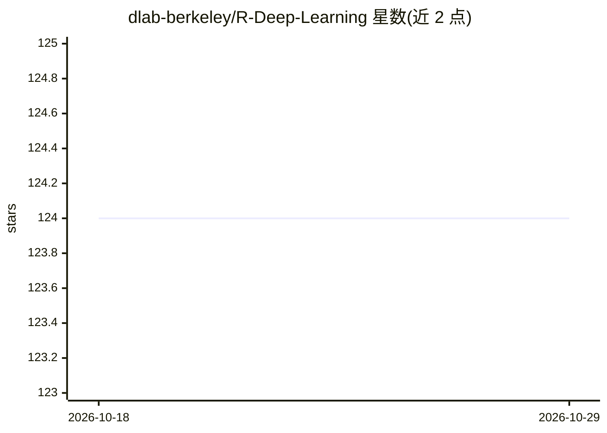

# dlab-berkeley/R-Deep-Learning

⭐ 124 · R · 推送 2026-06-02 · [GitHub](https://github.com/dlab-berkeley/R-Deep-Learning) · [官网](https://dlab-berkeley.github.io/Deep-Learning-in-R/slides.html) · 组织维护

**给 R 用户的深度学习入门工作坊教程（6 小时）**

UC Berkeley D-Lab 出品的六小时 R 深度学习教学材料库：以 TensorFlow 与 Keras（R 接口）讲解深度学习基础概念、图像分类项目工作流，并附带迁移学习、文本分析与可视化等内容。要求学员具备中级 R 水平，需本地安装 R、RStudio、TensorFlow 及相关 R 包（reticulate/tfhub/tfdatasets），也提供 DataHub 与 Binder 在线运行徽章。文末罗列课程、书籍等延伸学习资源。

## 筛选速览

| 维度 | 判定 | 备注 |
|---|---|---|
| AI 角色 | `ai-knowledge` | 知识聚合/清单类 |
| 许可风险 | `none` | — |
| 部署形态 | `None` |  |
| 模型依赖 | — | README 未给出锁定关系 |
| 硬件要求 | — | 无带数字的原话,不猜 |
| 安装摩擦 | `low` | 无编译、无系统依赖或容器化 |
| 成熟度 | — | 结构信号不足 |

## 能力要点

- 基于 R 的 TensorFlow/Keras 深度学习教学材料
- 覆盖图像分类与完整深度学习项目工作流
- 提供 DataHub 与 Binder 在线运行方式
- 附带安装步骤（R/RStudio/TensorFlow 及 R 包）

## 适用场景

- 系统入门 R 语言的深度学习开发
- 跟随课程材料实践图像分类项目
- 查找深度学习延伸学习资源

## 场景标签

`教程课程` · 领域:学习与行业

## 证据(README 行号)

> L8: This is the repository for D-Lab’s six-hour Introduction to Deep Learning in R
> L20: In this workshop, we provide an introduction to Deep Learning using TensorFlow

## 星数曲线

2026-10-18 124 → 2026-10-29 124（+0）

---
*卡片 v1 · prompt 1.4 · 生成 2026-10-23 · 置信度 high · 依据 README sha `9367171fb4d8` · [字段定义](../../DATASET.md)*
