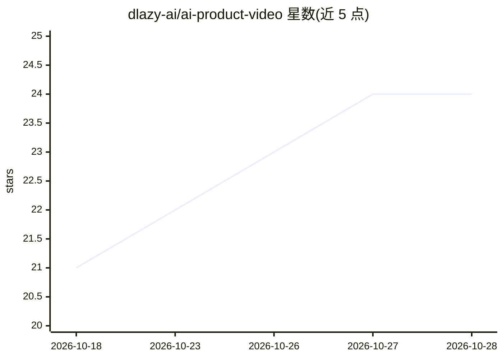

# dlazy-ai/ai-product-video

⭐ 24 · TypeScript · Apache-2.0 · 推送 2026-08-31 · [GitHub](https://github.com/dlazy-ai/ai-product-video) · 组织维护 · 中文 README

**面向 Claude Code/Codex 的产品宣传片制作技能库（152 镜头卡）**

一个 AI agent skill：装进 Claude Code 或 Codex 的 skills 目录后，把 agent 变成动效制作工作室——按 152 个镜头配方卡（209 风格变体）与调优的 Remotion TSX 实现，为产品生成分镜、动画与音效设计的宣传片。附带验证过的 Ink Press 模板（36.2 秒、10 镜头）。音乐、配音、字幕与 B-roll 需通过 dlazy CLI 获取；模板的截图素材不随附，需用户自行截取。

## 筛选速览

| 维度 | 判定 | 备注 |
|---|---|---|
| AI 角色 | `ai-knowledge` | 知识聚合/清单类 |
| 许可风险 | `permissive` | Apache-2.0 |
| 部署形态 | `library` | 以包/库形式分发 |
| 模型依赖 | locked-api |  |
| 硬件要求 | — | 无带数字的原话,不猜 |
| 安装摩擦 | `low` | 无编译、无系统依赖或容器化 |
| 成熟度 | — | 结构信号不足 |

## 能力要点

- 152 张镜头配方卡 / 209 个风格变体，附 Remotion 实现
- Ink Press 验证模板：36.2s、1920×1080、30fps、10 镜头
- 内置 149 个 SFX（16 类），无需账户即可使用
- 音乐/配音/字幕/B-roll 通过 dLazy CLI 统一生成

## 适用场景

- 让 Claude Code/Codex 为我的桌面或 Web 产品做宣传片
- 挑选镜头卡用于功能演示、品牌短片或发布视频
- 在 CI/无头 Linux 环境渲染 Remotion 视频

## 场景标签

`视频生成` · 领域:内容生成

## 证据(README 行号)

> L11: **ai-product-video** is an AI agent skill that turns Claude Code or Codex into a
> L17: 🖼️ **Browse the library** — read the cards in `references/shots/`,
> L161: ├── SKILL.md                 # Agent entry point and core production rules

## 星数曲线

2026-10-18 21 → 2026-10-28 24（+3）

---
*卡片 v1 · prompt 1.4 · 生成 2026-10-27 · 置信度 high · 依据 README sha `124d6fc4ef2f` · [字段定义](../../DATASET.md)*
