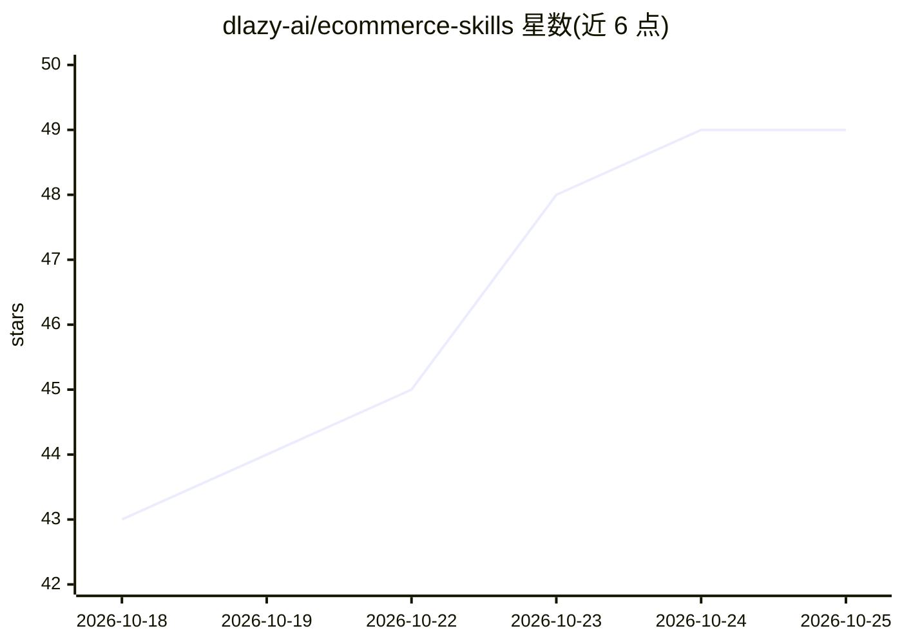

# dlazy-ai/ecommerce-skills

⭐ 49 · JavaScript · MIT · 推送 2026-10-19 · [GitHub](https://github.com/dlazy-ai/ecommerce-skills) · 组织维护 · 中文 README

**电商视觉生产的 Agent 技能库：26 个可组合 skill.md 生成商品图**

把电商商品图制作拆成 26 个可组合技能（平铺图上身、裂变套图、详情页、主图视频、投前质检、合规校验），每个技能是可执行的 skill.md 配套脚本。不锁后端：dLazy 默认，可切换 OpenAI / Gemini / fal / Replicate / 火山方舟，自带 key 即可，无 key 可 --dry-run 空跑。批量、重试、断点续跑、成本熔断、合规校验等确定性动作由脚本完成，所有示例命令可原样复现。面向需要规模化生成电商视觉素材的卖家/团队，通过 npm 安装 dLazy CLI 使用。

## 筛选速览

| 维度 | 判定 | 备注 |
|---|---|---|
| AI 角色 | `ai-native` | 本体是模型或模型工具 |
| 许可风险 | `permissive` | MIT |
| 部署形态 | `library` | 以包/库形式分发 |
| 模型依赖 | — | README 未给出锁定关系 |
| 硬件要求 | — | 无带数字的原话,不猜 |
| 安装摩擦 | `medium` | 含编译或系统依赖之一 |
| 成熟度 | — | 结构信号不足 |

## 能力要点

- 26 个可组合 skill.md 覆盖平铺上身→套图→详情页→视频→质检链路
- 不锁后端：dLazy / OpenAI / Gemini / fal / Replicate / 火山方舟可切换，自带 key 即可
- 批量、重试、断点续跑、成本熔断、合规校验等确定性动作脚本化
- 投前 AI 图质检输出风险等级与修正建议，可闭环重跑

## 适用场景

- 没有摄影棚和模特，用平铺图生成模特上身商拍图
- 一张商品图批量裂变主图/场景图/细节图整套素材
- 投放前机检 AI 生成图的平台合规与文字乱码风险

## 场景标签

`图像生成` `视频生成` · 领域:内容生成

## 证据(README 行号)

> L11: 一套面向**电商视觉生产**的 Agent 技能库：把「拍商品图」这件事拆成 26 个可组合的技能，
> L17: - **不锁后端** —— dLazy 默认，也能用 OpenAI / Gemini / fal / Replicate / 火山方舟，自带 key 即可；没 key 也能 `--dry-run` 空跑看清要发什么。
> L18: - **确定性动作交给脚本** —— 批量、重试、断点续跑、成本熔断、合规校验、闭环重跑都是脚本，不靠模型每次现编。

## 星数曲线

2026-10-18 43 → 2026-10-25 49（+6）

---
*卡片 v1 · prompt 1.4 · 生成 2026-10-24 · 置信度 mid · 依据 README sha `bfbf6fddc53d` · [字段定义](../../DATASET.md)*
