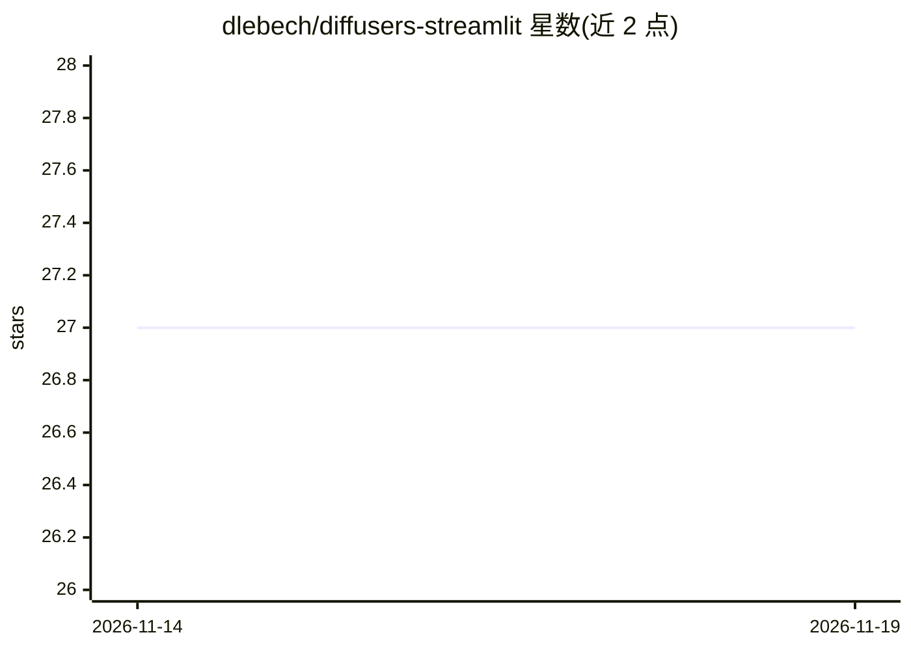

# dlebech/diffusers-streamlit

⭐ 27 · Python · CC0-1.0 · 推送 2026-11-18 · [GitHub](https://github.com/dlebech/diffusers-streamlit) · 个人维护

**用 Streamlit 玩开源文生图模型的极简 Web 界面**

单文件 Streamlit 应用，封装 Z-Image Turbo、FLUX.2 [klein] 4B 与 Stable Diffusion XL 系列（含 SDXL Turbo、XL refiner）的 txt2img、img2img 与 inpainting，带负向提示词、步数/引导系数滑杆（按模型预设合理值）与每模型提示。首次运行自动从 Hugging Face 下载模型（Z-Image Turbo 约 33GB 磁盘），在低显存 GPU 上自动启用 CPU offload，生成图与设置记录保存到 outputs/ 目录。作者在 8GB RTX 2070 上开发，需 Python 3.12 与 Nvidia 驱动，8GB 显存下常见显存溢出需清缓存重跑。

## 筛选速览

| 维度 | 判定 | 备注 |
|---|---|---|
| AI 角色 | `ai-native` | 本体是模型或模型工具 |
| 许可风险 | `viral` | CC0-1.0 |
| 部署形态 | `library` | 以包/库形式分发 |
| 模型依赖 | — | README 未给出锁定关系 |
| 硬件要求 | — | 无带数字的原话,不猜 |
| 安装摩擦 | `medium` | 含编译或系统依赖之一 |
| 成熟度 | — | 结构信号不足 |

## 能力要点

- txt2img/img2img/inpainting 三种管线，覆盖 4 个开源图像生成模型
- 按模型预设步数、引导系数与原生分辨率，并附简短提示
- 显存不足 24GB 时自动开启 CPU offload（Z-Image Turbo 峰值约 12GB）
- 输出图片旁自动生成记录 prompt、模型与参数的 .txt 文件

## 适用场景

- 本地跑 Z-Image Turbo / FLUX.2 / SDXL 生成与编辑图片
- 不想装复杂 WebUI 时用极简界面快速试模型
- 用 img2img/inpaint 做图像替换与局部重绘

## 场景标签

`图像生成` · 领域:内容生成

## 证据(README 行号)

> L3: A *super minimal* Streamlit app for playing around with open image generation models: Z-Image Turbo, FLUX.2 [klein] 
> L6: - Text to image (txt2img): Z-Image Turbo, FLUX.2 [klein] 4B, XL 1.0, SDXL Turbo
> L7: - Image to image (img2img): Z-Image Turbo, FLUX.2 [klein] 4B, XL 1.0 refiner
> L8: - Inpainting: Z-Image Turbo, FLUX.2 [klein] 4B, XL 1.0

## 星数曲线

2026-11-14 27 → 2026-11-19 27（+0）

---
*卡片 v1 · prompt 1.4 · 生成 2026-11-18 · 置信度 high · 依据 README sha `2358f63ab2be` · [字段定义](../../DATASET.md)*
