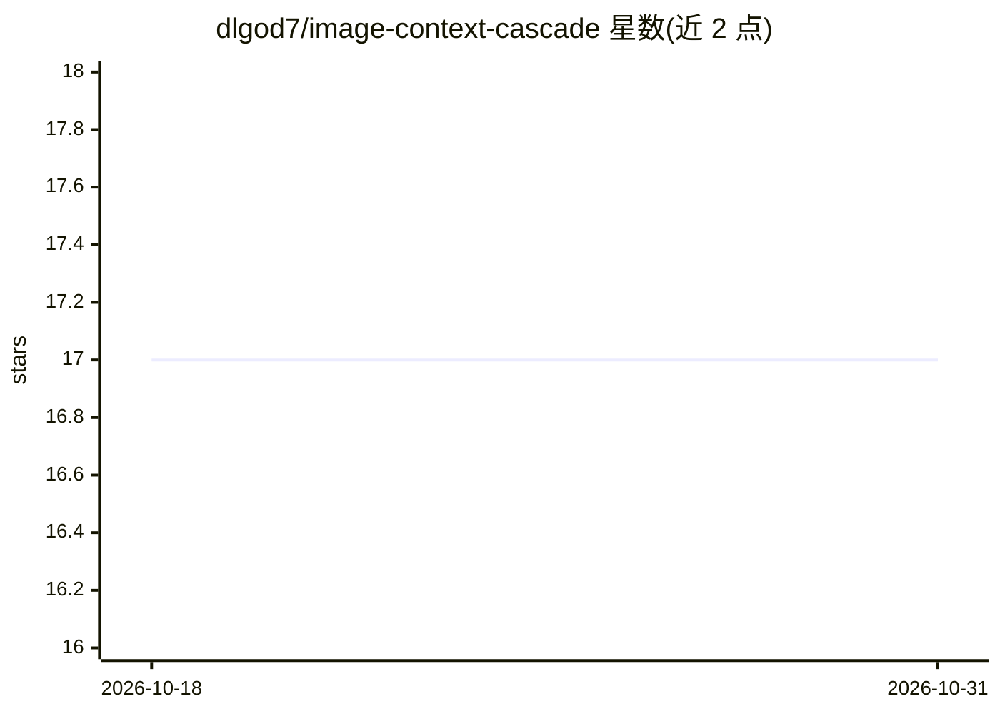

# dlgod7/image-context-cascade

⭐ 17 · TypeScript · NOASSERTION · 推送 2026-10-18 · [GitHub](https://github.com/dlgod7/image-context-cascade) · 个人维护 · 中文 README

**AI 编码 agent 的请求级图片生命周期中间件：历史图片降级为占位符**

面向 Codex、Claude Code 等 AI 编码 agent 用户的开源中间件：在请求离开进程前，将历史轮次的 base64 图片降级为可恢复的轻量文本占位符，当前轮图片保持原样，以缩小请求体、降低 token 消耗并避免 413。机制包括三档分级（热/温/冷）、按位置确定性的分类策略、按内容哈希存档与恢复。支持 Anthropic/OpenAI Chat/OpenAI Responses 三种 payload 格式；零运行时依赖。各 agent 接入深度不同：Pi 全自动，Claude Code/Codex 经 SessionEnd hook 会话边界归档，其余走手动 CLI。限制：仅处理图片不压缩文本、远程 URL 图片不抓取、仅字节级一致性匹配。

## 筛选速览

| 维度 | 判定 | 备注 |
|---|---|---|
| AI 角色 | `ai-ecosystem` | LLM/agent 周边工具 |
| 许可风险 | `none` | NOASSERTION |
| 部署形态 | `library` | 以包/库形式分发 |
| 模型依赖 | — | README 未给出锁定关系 |
| 硬件要求 | — | 无带数字的原话,不猜 |
| 安装摩擦 | `low` | 无编译、无系统依赖或容器化 |
| 成熟度 | — | 结构信号不足 |

## 能力要点

- 三档图片生命周期（热：当前轮完整发送；温：可选缩略图；冷：稳定可恢复占位符）
- 按内容哈希存档，每个被降级的图片均可通过 image-cascade restore 恢复
- 分类按位置确定进行，无模型参与内容判断；分类失败时 fail-open 全保留
- 支持 Anthropic / OpenAI Chat / OpenAI Responses payload 格式，零运行时依赖

## 适用场景

- 粘贴大量截图的 agent 会话膨胀后做瘦身与救援
- 给自研 agent 框架在请求构造层接入 cascadeImages() 降级历史图片
- 按需恢复会话中已归档的历史图片重新查看

## 场景标签

 · 领域:LLM 基础设施/agent 工具

## 证据(README 行号)

> L7: `image-context-cascade` downgrades historical images to restorable lightweight placeholders *before* the request lea
> L15: Compaction can't save you — and not for lack of trying. A 413 happens the moment the request leaves your process, b
> L81: |Your own agent / framework|`cascadeImages()` at request construction|Fully automatic, every request|

## 星数曲线

2026-10-18 17 → 2026-10-31 17（+0）

---
*卡片 v1 · prompt 1.4 · 生成 2026-10-29 · 置信度 high · 依据 README sha `1d264b3715c3` · [字段定义](../../DATASET.md)*
