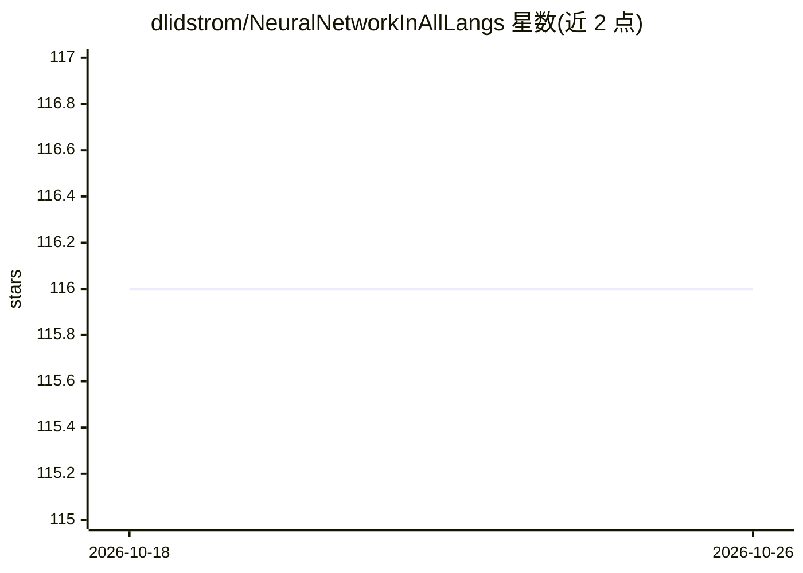

# dlidstrom/NeuralNetworkInAllLangs

⭐ 116 · Java · MIT · 推送 2026-10-14 · [GitHub](https://github.com/dlidstrom/NeuralNetworkInAllLangs) · 个人维护

**用各主流语言实现的入门级全连接神经网络教学仓库**

在 Rust、F#、C#、C++、C、Kotlin、Go、Java、Zig、Python 等 10 种语言中实现同一套单隐层 sigmoid 全连接网络，通过随机梯度反向传播训练，可学习 xor/xnor 等 6 种逻辑函数并用 Semeion 手写数字数据集做识别（示例达到 99.1% 准确率，14 个隐藏神经元）。代码目标是无依赖、易复制粘贴，统一随机数算法使各实现学到相同权重；各实现按 Level 0-4 成熟度模型分级。面向爱好者与入门程序员，非面向生产性能场景，README 明确声明性能不是目标。

## 筛选速览

| 维度 | 判定 | 备注 |
|---|---|---|
| AI 角色 | `ai-native` | 本体是模型或模型工具 |
| 许可风险 | `permissive` | MIT |
| 部署形态 | `None` |  |
| 模型依赖 | — | README 未给出锁定关系 |
| 硬件要求 | — | 无带数字的原话,不猜 |
| 安装摩擦 | `medium` | 含编译或系统依赖之一 |
| 成熟度 | — | 结构信号不足 |

## 能力要点

- 10 种语言实现同一套单隐层全连接网络
- 统一随机数生成器使各实现学到相同权重，逻辑函数用例可作实现正确性检验
- Semeion 手写数字识别示例达 99.1% 准确率
- 无依赖、可复制粘贴的代码目标，实现按 Level 0-4 分级

## 适用场景

- 学习神经网络从零实现的原理与代码结构
- 对比不同编程语言实现同一算法的方式
- 把一份无依赖的网络实现复制到自己的项目中

## 场景标签

`教程课程` · 领域:学习与行业

## 证据(README 行号)

> L35: This repository aims to implement a vanilla neural network in all major
> L39: network can be used to do hand writing recognition, or other kinds of pattern

## 星数曲线

2026-10-18 116 → 2026-10-26 116（+0）

---
*卡片 v1 · prompt 1.4 · 生成 2026-10-23 · 置信度 high · 依据 README sha `c3f9cef87590` · [字段定义](../../DATASET.md)*
