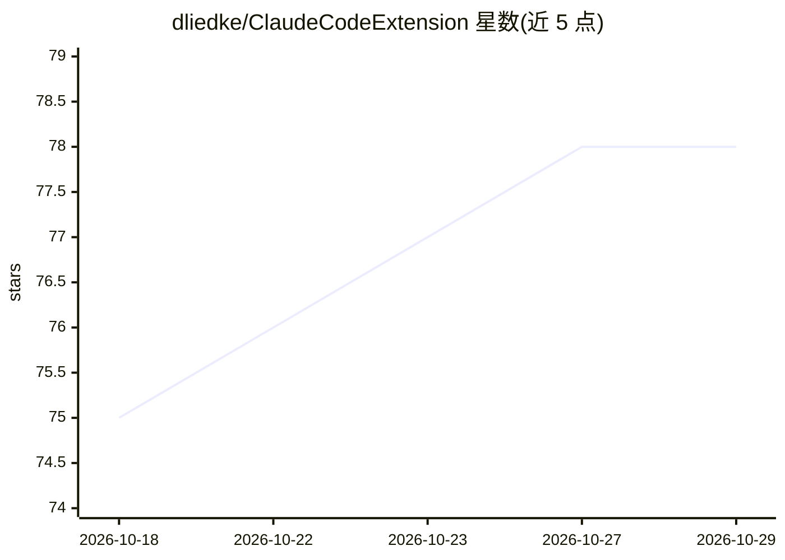

# dliedke/ClaudeCodeExtension

⭐ 78 · C# · MIT · 推送 2026-10-27 · [GitHub](https://github.com/dliedke/ClaudeCodeExtension) · [官网](https://marketplace.visualstudio.com/items?itemName=dliedke.ClaudeCodeExtension) · 个人维护

**Visual Studio 扩展：在 IDE 内承载多种 AI 编程代理的统一界面**

面向 Windows + Visual Studio 2022/2026 的扩展，以原生聊天标签页或内嵌终端方式运行 Claude Code、OpenAI Codex、Cursor Agent、Open Code、Devin、PI、Google Antigravity、Reasonix、Qwen Code、Grok 等 AI 编程代理，并提供图片/文件粘贴、集成 diff 查看器、代理结束后的自动化动作（构建/测试/脚本）、用量追踪、会话历史、自定义命令与 GitHub Issues 自动修复等功能。通过 VSIX 文件或 Visual Studio 扩展管理器安装；各 AI 代理本身需单独安装与订阅。

## 筛选速览

| 维度 | 判定 | 备注 |
|---|---|---|
| AI 角色 | `ai-ecosystem` | LLM/agent 周边工具 |
| 许可风险 | `permissive` | MIT |
| 部署形态 | `desktop` | 安装包/桌面程序 |
| 模型依赖 | locked-api |  |
| 硬件要求 | — | 无带数字的原话,不猜 |
| 安装摩擦 | `medium` | 含编译或系统依赖之一 |
| 成熟度 | — | 结构信号不足 |

## 能力要点

- 以原生聊天或内嵌终端承载 10 种 AI 编程代理
- 集成 diff 查看器与逐文件 Keep/Undo 审查
- 代理结束时可自动执行构建、测试、脚本或跟进命令
- GitHub Issues 列表化并在独立分支中逐条修复、合并与回复

## 适用场景

- 在 Visual Studio 中不切换工具地使用 Claude Code、Codex 等代理
- 审查代理对代码文件的逐项修改并保留或撤销
- 构建出错或运行时异常时自动发给代理修复

## 场景标签

`编码 Agent` · 领域:编码与开发

## 证据(README 行号)

> L5: Native chat or terminal inside Visual Studio for the best AI coding agents on the market: **Claude Code, OpenAI Code
> L83: By default only **Claude Code** is shown in the agent picker — use *⚙ → Configure Visible Code Agents...* to opt in
> L85: |Provider|Platform|Command|Subscription / Notes|

## 星数曲线

2026-10-18 75 → 2026-10-29 78（+3）

---
*卡片 v1 · prompt 1.4 · 生成 2026-10-24 · 置信度 mid · 依据 README sha `0c3489dade40` · [字段定义](../../DATASET.md)*
