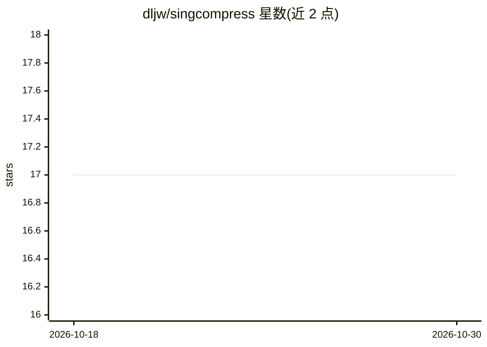

# dljw/singcompress

⭐ 17 · TypeScript · MIT · 推送 2026-04-12 · [GitHub](https://github.com/dljw/singcompress) · [官网](https://github.com/dljw/singcompress) · 个人维护

**让 AI 编程助手用 Singlish 语法压缩回复以省 token 的技能**

一个以 SKILL.md 形式分发的系统提示词技能：指示 LLM 采用 Singlish（新加坡英语）语法模式压缩自然语言回复，代码块、错误信息、JSON 等技术内容保持不变。提供三档压缩级别（siudai/medium/gao），并带 Auto-Clarity 安全模式，安全警告等场景自动回退标准英语。基准测试（24 条提示、3 个 Claude 模型）显示 medium 档 Sonnet 上 token 减少 72%，超出通用『be concise』提示 16-32%。安装方式覆盖 Claude Code 插件市场与 Vercel Skills CLI（支持 Cursor、Copilot、Windsurf 等 40+ 编程代理）。限制：对 Haiku 等模型 heavy 档效果下降甚至变差。

## 筛选速览

| 维度 | 判定 | 备注 |
|---|---|---|
| AI 角色 | `ai-ecosystem` | LLM/agent 周边工具 |
| 许可风险 | `permissive` | MIT |
| 部署形态 | `library` | 以包/库形式分发 |
| 模型依赖 | locked-api |  |
| 硬件要求 | — | 无带数字的原话,不猜 |
| 安装摩擦 | `low` | 无编译、无系统依赖或容器化 |
| 成熟度 | — | 结构信号不足 |

## 能力要点

- SKILL.md 系统提示词技能，非后处理器或代理，模型直接生成压缩输出
- 三档压缩级别，medium 档 Sonnet 上测试 token 减少 72%
- Auto-Clarity 模式：安全警告与不可逆操作自动回退标准英语
- 支持 Claude Code 插件市场与 Vercel Skills CLI（40+ 编程代理）

## 适用场景

- 降低 AI 编程助手的 API 输出 token 成本
- 加快长解释类回复的生成速度
- 在 Claude Code / Cursor / Copilot 等代理中按需切换压缩级别

## 场景标签

`提示工程` · 领域:Agent 开发

## 证据(README 行号)

> L71: ## How It Works
> L73: SingCompress is a system prompt that instructs the LLM to respond using Singlish grammatical patterns that naturall

## 星数曲线

2026-10-18 17 → 2026-10-30 17（+0）

---
*卡片 v1 · prompt 1.4 · 生成 2026-10-29 · 置信度 high · 依据 README sha `944f152815c8` · [字段定义](../../DATASET.md)*
