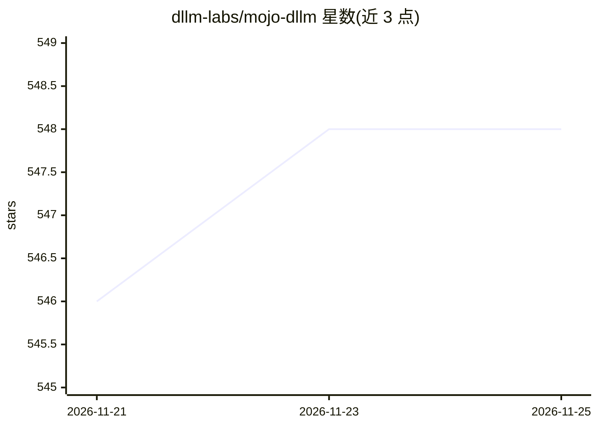

# dllm-labs/mojo-dllm

⭐ 548 · Python · Apache-2.0 · 推送 2026-11-22 · [GitHub](https://github.com/dllm-labs/mojo-dllm) · [官网](https://dllm-labs.github.io/mojo-dllm/) · 组织维护

**扩散语言模型本地推理运行时，支持 LLaDA/Dream 的 GGUF 量化模型**

用 Mojo 编写的本地推理运行时，从 GGUF 量化文件运行 LLaDA-8B-Instruct、LLaDA-1.5、Dream-v0-Instruct-7B、Dream-Coder 与 DiffuCoder 五个扩散语言模型。GGUF 读取、tokenizer、量化矩阵乘、GPU kernel 与去噪循环均为 Mojo 实现，二进制运行时无需 Python，GPU 可选。要求 Linux x86-64、AVX2、glibc 2.34+、约 6GB 内存；NVIDIA GPU 需 compute capability 8.0+。通过 git clone 源码加 uv 启动脚本构建运行，README 含 CPU/GPU 基准表与正确性对照结果。

## 筛选速览

| 维度 | 判定 | 备注 |
|---|---|---|
| AI 角色 | `ai-native` | 本体是模型或模型工具 |
| 许可风险 | `permissive` | Apache-2.0 |
| 部署形态 | `None` |  |
| 模型依赖 | — | README 未给出锁定关系 |
| 硬件要求 | — | 无带数字的原话,不猜 |
| 安装摩擦 | `medium` | 含编译或系统依赖之一 |
| 成熟度 | — | 结构信号不足 |

## 能力要点

- 从量化 GGUF 文件运行 LLaDA 与 Dream 系列扩散语言模型
- CPU 与 NVIDIA GPU（int8 tensor cores）双后端，运行时无需 Python
- 权重按 AVX-VNNI 重排的 skinny GEMM 与混合 CPU 线程调度
- README 内置由结果文件渲染的基准表与 llama.cpp 对齐的正确性检查

## 适用场景

- 在本地 CPU 上运行扩散语言模型生成文本
- 在 NVIDIA GPU 上以低显存占用运行 LLaDA/Dream 量化模型
- 读取和检查 GGUF 格式的扩散模型权重文件

## 场景标签

`推理引擎` · 领域:训练与推理

## 证据(README 行号)

> L5:  Local inference for diffusion language models, written in Mojo.
> L21: mojo-dllm runs **LLaDA-8B-Instruct**, **LLaDA-1.5**, **Dream-v0-Instruct-7B**,
> L27: and the denoising loop are all Mojo. The `build/mojo-dllm` binary needs no

## 星数曲线

2026-11-21 546 → 2026-11-25 548（+2）

---
*卡片 v1 · prompt 1.4 · 生成 2026-11-21 · 置信度 high · 依据 README sha `8072b8ae02fe` · [字段定义](../../DATASET.md)*
