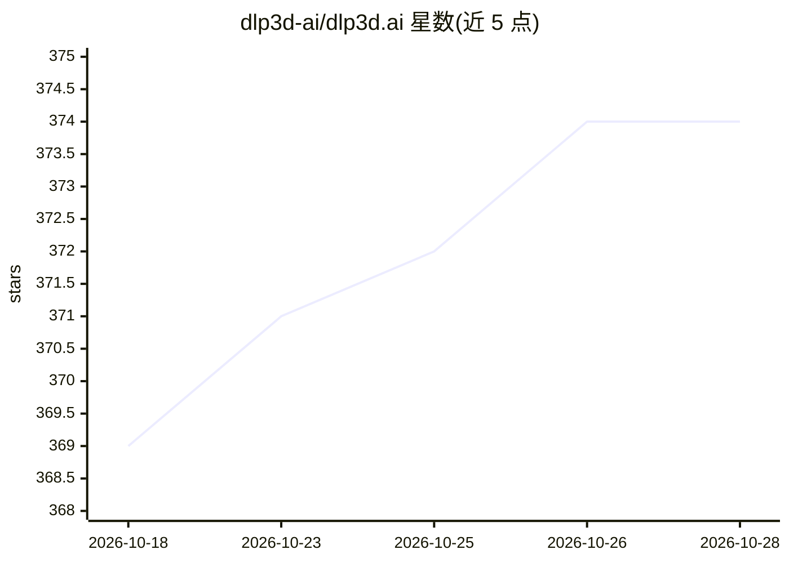

# dlp3d-ai/dlp3d.ai

⭐ 374 · TypeScript · MIT · 推送 2026-05-25 · [GitHub](https://github.com/dlp3d-ai/dlp3d.ai) · [官网](https://dlp3d.readthedocs.io) · 组织维护 · 中文 README

**开源实时框架：通过3D数字人形象与LLM进行语音对话**

Digital Life Project 2 (DLP3D) 是开源实时框架，将大语言模型与可定制的 3D 虚拟形象结合：用户以语音对话，角色在浏览器中回应统一的音频、全身动画与物理仿真。外观（3D 模型）与性格（角色提示词）均可定制，可接入任意 LLM 或 TTS 服务。组织下含 orchestrator、web_backend、speech2motion、audio2face 等多个仓库。提供本地部署（需自备 API key）与免费托管服务两种使用方式，SIGGRAPH Asia 2025 Real-Time Live 展示项目。

## 筛选速览

| 维度 | 判定 | 备注 |
|---|---|---|
| AI 角色 | `ai-native` | 本体是模型或模型工具 |
| 许可风险 | `permissive` | MIT |
| 部署形态 | `None` |  |
| 模型依赖 | — | README 未给出锁定关系 |
| 硬件要求 | — | 无带数字的原话,不猜 |
| 安装摩擦 | `low` | 无编译、无系统依赖或容器化 |
| 成熟度 | — | 结构信号不足 |

## 能力要点

- 语音对话驱动的 3D 数字人，浏览器内实时音频+全身动画+物理仿真
- 角色外观与性格（提示词）均可定制
- 可适配任意 LLM 与 TTS 服务
- 多仓库架构：orchestrator/web_backend/speech2motion/audio2face 等

## 适用场景

- 与可定制的 3D 角色进行实时语音对话
- 本地部署并接入自己的 LLM/TTS API 搭建数字人
- 研究语音到动作、音频到面部的动画生成

## 场景标签

`语音 Agent` · 领域:对话与助手

## 证据(README 行号)

> L6: Digital Life Project 2 (DLP3D) is an open-source real-time framework that brings Large Language Models (LLMs) to lif
> L20: - speech2motion: converts speech into body animation.
> L21: - audio2face: generates facial animation from audio.

## 星数曲线

2026-10-18 369 → 2026-10-28 374（+5）

---
*卡片 v1 · prompt 1.4 · 生成 2026-10-22 · 置信度 high · 依据 README sha `45f68b5111d7` · [字段定义](../../DATASET.md)*
