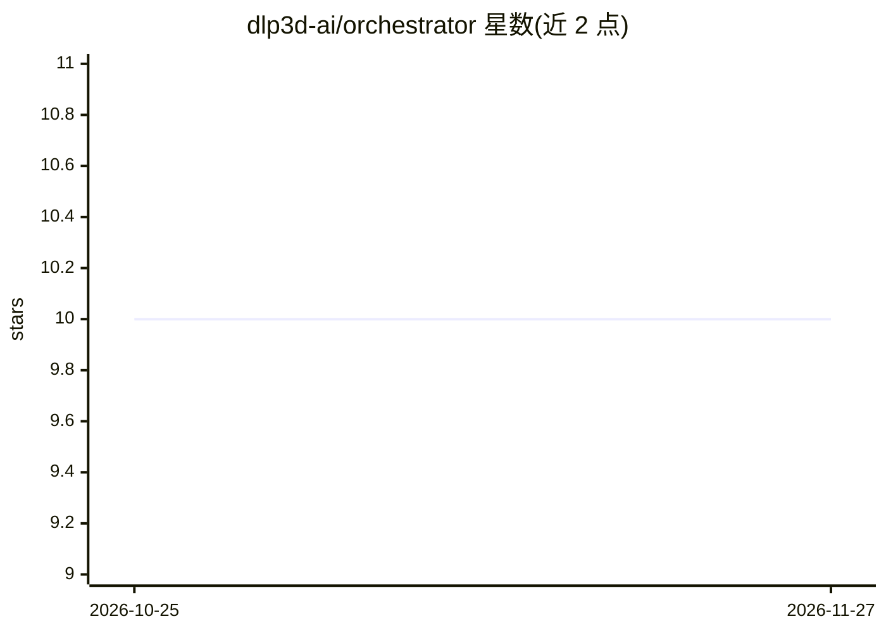

# dlp3d-ai/orchestrator

⭐ 10 · Python · MIT · 推送 2026-05-25 · [GitHub](https://github.com/dlp3d-ai/orchestrator) · 组织维护 · 中文 README

**面向开发者的多模态实时对话工作流编排系统**

以 DAG 工作流管理 ASR、LLM 对话、TTS、情绪分析、记忆管理与 3D 动画生成（Audio2Face & Speech2Motion）等模块的编排系统，通过适配器接入多家 AI 服务商，支持流式传输与音频/文本/混合会话模式。主要场景为角色扮演、虚拟伴侣、教育、客服与办公助手。部署方式包括 Docker Compose 完整服务（含 MongoDB 等依赖）或独立服务，本地开发需 Python 3.10+ 与 Protocol Buffers 编译器。

## 筛选速览

| 维度 | 判定 | 备注 |
|---|---|---|
| AI 角色 | `ai-ecosystem` | LLM/agent 周边工具 |
| 许可风险 | `permissive` | MIT |
| 部署形态 | `self-host` | docker 或自建部署 |
| 模型依赖 | locked-api |  |
| 硬件要求 | — | 无带数字的原话,不猜 |
| 安装摩擦 | `low` | 无编译、无系统依赖或容器化 |
| 成熟度 | — | 结构信号不足 |

## 能力要点

- DAG 工作流架构管理多模块 AI 交互流程（proxy.py 核心编排）
- 适配器模式接入多家 LLM/ASR/TTS 服务商，可按场景组合
- 多级会话记忆、情绪状态与关系状态管理
- 3D 动画生成：语音转动作与音频转面部表情

## 适用场景

- 搭建可定制的语音+文本实时虚拟角色对话
- 构建带情绪分析与记忆的虚拟伴侣或客服
- 为数字人生成与语音同步的面部表情和动作

## 场景标签

`工作流自动化` `语音 Agent` `多模态` · 领域:效率与自动化

## 证据(README 行号)

> L12: Orchestrator is a real-time intelligent conversation system for building personalized multimodal AI interaction wor
> L96: - **Function**: Manages DAG workflows, coordinates interactions between all modules
> L103: The system uses a Directed Acyclic Graph (DAG) architecture to manage complex AI interaction workflows. Each conve

## 星数曲线

2026-10-25 10 → 2026-11-27 10（+0）

---
*卡片 v1 · prompt 1.4 · 生成 2026-11-19 · 置信度 high · 依据 README sha `878c69bb7d9e` · [字段定义](../../DATASET.md)*
