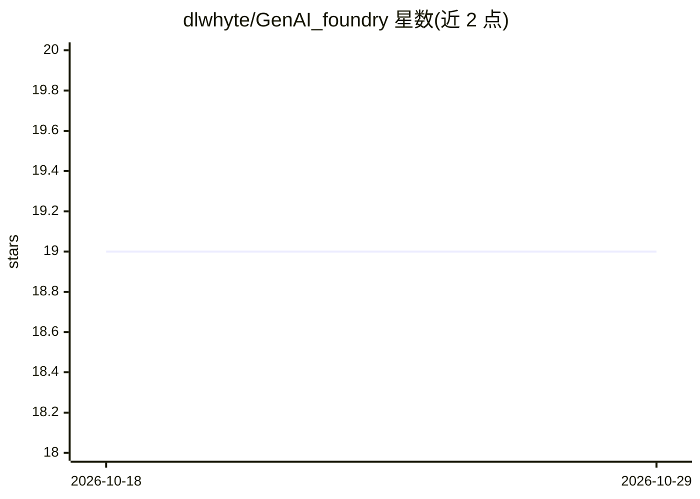

# dlwhyte/GenAI_foundry

⭐ 19 · Jupyter Notebook · MIT · 推送 2026-04-11 · [GitHub](https://github.com/dlwhyte/GenAI_foundry) · 个人维护

**生成式 AI 入门教程库：Notebook 课程与 Streamlit 交互演示**

面向初学者的生成式 AI 学习仓库：提供 12 个可在 Google Colab 直接运行的 Notebook，按 Token/嵌入、语义搜索、Prompt 工程、RAG、LangChain 基础、Agent 概念组织成学习路径；Part 1 无需 API key，Part 2 需 OpenAI key。另含一个多页 Streamlit 演示应用（RAG 可视化探索、本体与反事实推理、基于 FAISS 的 RAG 聊天），以单个 Docker 容器运行，部分功能需 OpenAI key。配有学生快速上手 PDF 指南，MIT 许可。

## 筛选速览

| 维度 | 判定 | 备注 |
|---|---|---|
| AI 角色 | `ai-knowledge` | 知识聚合/清单类 |
| 许可风险 | `permissive` | MIT |
| 部署形态 | `self-host` | docker 或自建部署 |
| 模型依赖 | — | README 未给出锁定关系 |
| 硬件要求 | — | 无带数字的原话,不猜 |
| 安装摩擦 | `low` | 无编译、无系统依赖或容器化 |
| 成熟度 | — | 结构信号不足 |

## 能力要点

- 12 个 Colab Notebook 组成从 Token 到 Agent 的学习路径
- 无 API key 的 Notebook 可在 Colab 免费运行
- 多页 Streamlit 演示：RAG 可视化、本体推理、FAISS 文档问答
- Docker 单容器运行演示应用

## 适用场景

- 零基础学习 LLM、嵌入与 RAG 的原理
- 通过可视化演示理解 RAG 流水线内部过程
- 上传自己的 PDF/TXT 体验端到端文档问答

## 场景标签

`教程课程` `RAG` `文档问答` · 领域:知识与检索

## 证据(README 行号)

> L15: - 🚀 Empower learners to experiment with LLMs and RAG pipelines.
> L16: - 🧠 Provide clear, beginner-friendly tutorials.
> L32: ① Tokens & Embeddings → ② Semantic Similarity → ③ Search with Embeddings → ④ Model Tradeoffs

## 星数曲线

2026-10-18 19 → 2026-10-29 19（+0）

---
*卡片 v1 · prompt 1.4 · 生成 2026-10-28 · 置信度 high · 依据 README sha `0b7f412a029f` · [字段定义](../../DATASET.md)*
