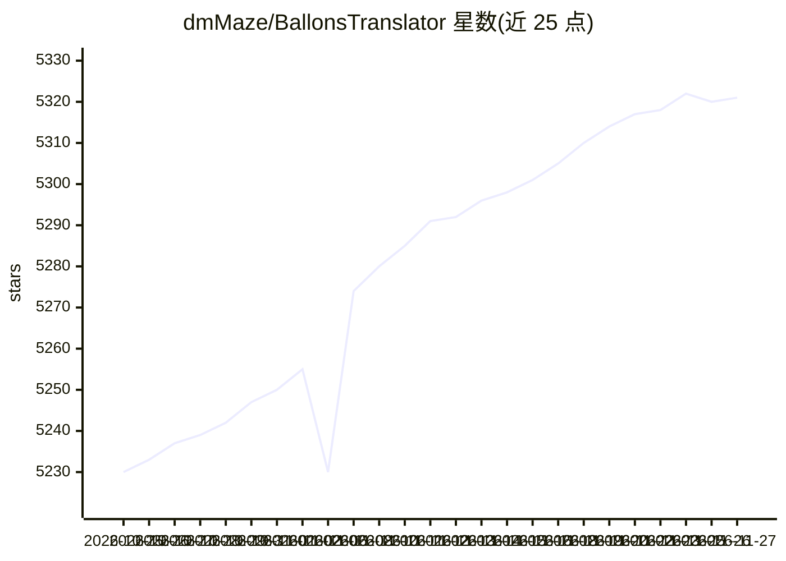

# dmMaze/BallonsTranslator

⭐ 5,321 · Python · GPL-3.0 · 推送 2026-11-26 · [GitHub](https://github.com/dmMaze/BallonsTranslator) · 个人维护 · 中文 README

**深度学习辅助的漫画翻译工具：一键机翻加图像文本编辑**

基于 PySide/PyQt 的桌面漫画翻译工具，流水线包含文本检测、OCR、图像修复（抹字）与机器翻译四个模块，支持日漫和美漫，译文回填参考原排版（颜色、轮廓、角度、对齐）。翻译器可选谷歌、彩云、papago、DeepL、Sugoi、m2m100、Sakura-13B 及 OpenAI 兼容 LLM 接口，LLM 翻译支持上下文翻译历史、可复用术语表、视觉上下文与摘要记忆机制，并提供 Token 预算与缓存费用估算。提供图形界面、无 GUI 命令行模式，Windows/macOS/Linux 均有安装脚本或免配置压缩包。

## 筛选速览

| 维度 | 判定 | 备注 |
|---|---|---|
| AI 角色 | `ai-native` | 本体是模型或模型工具 |
| 许可风险 | `viral` | GPL-3.0 |
| 部署形态 | `desktop` | 安装包/桌面程序 |
| 模型依赖 | — | README 未给出锁定关系 |
| 硬件要求 | — | 无带数字的原话,不猜 |
| 安装摩擦 | `medium` | 含编译或系统依赖之一 |
| 成熟度 | — | 结构信号不足 |

## 能力要点

- 一键机翻：文本检测、OCR、抹字、翻译四模块流水线
- LLM 翻译支持翻译历史、术语表、单页摘要与项目级记忆
- 支持掩膜编辑、修复画笔与所见即所得富文本嵌字
- 无 GUI 命令行批处理模式，设置从 config.json 导入

## 适用场景

- 批量机翻日漫/美漫并手动校对嵌字
- 导出 word 或 LabelPlus txt 交由 PS/ID 后期嵌字
- 本地离线运行 Sakura/m2m100 模型翻译galgame文本

## 场景标签

`图像视频处理` `OCR` · 领域:感知与多模态

## 证据(README 行号)

> L9:  深度学习辅助漫画翻译工具，支持一键机翻和简单的图像/文本编辑
> L21: * 一键机翻
> L23:  - 最后效果取决于文本检测，识别，抹字，机翻四个模块的整体表现

## 星数曲线

2026-10-25 5,230 → 2026-11-27 5,321（+91）

---
*卡片 v1 · prompt 1.4 · 生成 2026-11-27 · 置信度 high · 依据 README sha `c33efc856792` · [字段定义](../../DATASET.md)*
