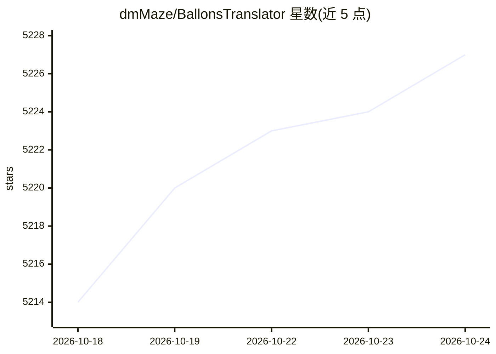

# dmMaze/BallonsTranslator

⭐ 5,227 · Python · GPL-3.0 · 推送 2026-10-23 · [GitHub](https://github.com/dmMaze/BallonsTranslator) · 个人维护 · 中文 README

**深度学习辅助的漫画机翻与图像/文本编辑桌面工具**

面向漫画译者与个人用户的 PyQt6 桌面工具：一键完成文本检测、OCR、抹字修复与机翻回填，译文格式参考原文排版（颜色、角度、对齐等），支持日漫/美漫与条漫。集成多种翻译器（OpenAI 兼容 LLM、DeepL、谷歌、Sakura-13B、m2m100 等），LLM 翻译支持翻译历史、术语表、视觉上下文与摘要记忆。内置掩膜编辑、修复画笔与富文本编辑，可导出 word 文档，并提供无 GUI 命令行模式。重度依赖 manga-image-translator 项目，Windows 7 不受支持。

## 筛选速览

| 维度 | 判定 | 备注 |
|---|---|---|
| AI 角色 | `ai-native` | 本体是模型或模型工具 |
| 许可风险 | `viral` | GPL-3.0 |
| 部署形态 | `desktop` | 安装包/桌面程序 |
| 模型依赖 | — | README 未给出锁定关系 |
| 硬件要求 | — | 无带数字的原话,不猜 |
| 安装摩擦 | `medium` | 含编译或系统依赖之一 |
| 成熟度 | — | 结构信号不足 |

## 能力要点

- 一键机翻流水线：检测、OCR、修复、翻译、排版回填
- LLM 翻译支持翻译历史、可复用术语表、视觉上下文与摘要记忆
- 多种本地与在线翻译器（OpenAI 兼容、DeepL、Sakura-13B、m2m100、Sugoi 等）
- 图像修复（AOT/lama/patchmatch）与富文本编辑、word 导入导出

## 适用场景

- 个人汉化/英化漫画的一键机翻初稿
- 对漫画文本进行 OCR、抹字与嵌字排版编辑
- 用术语表和翻译历史保持系列漫画译名一致

## 场景标签

`OCR` `图像视频处理` · 领域:感知与多模态

## 证据(README 行号)

> L9:  深度学习辅助漫画翻译工具，支持一键机翻和简单的图像/文本编辑
> L21: * 一键机翻
> L23:  - 最后效果取决于文本检测，识别，抹字，机翻四个模块的整体表现

## 星数曲线

2026-10-18 5,214 → 2026-10-24 5,227（+13）

---
*卡片 v1 · prompt 1.4 · 生成 2026-10-20 · 置信度 high · 依据 README sha `5c06e5523410` · [字段定义](../../DATASET.md)*
