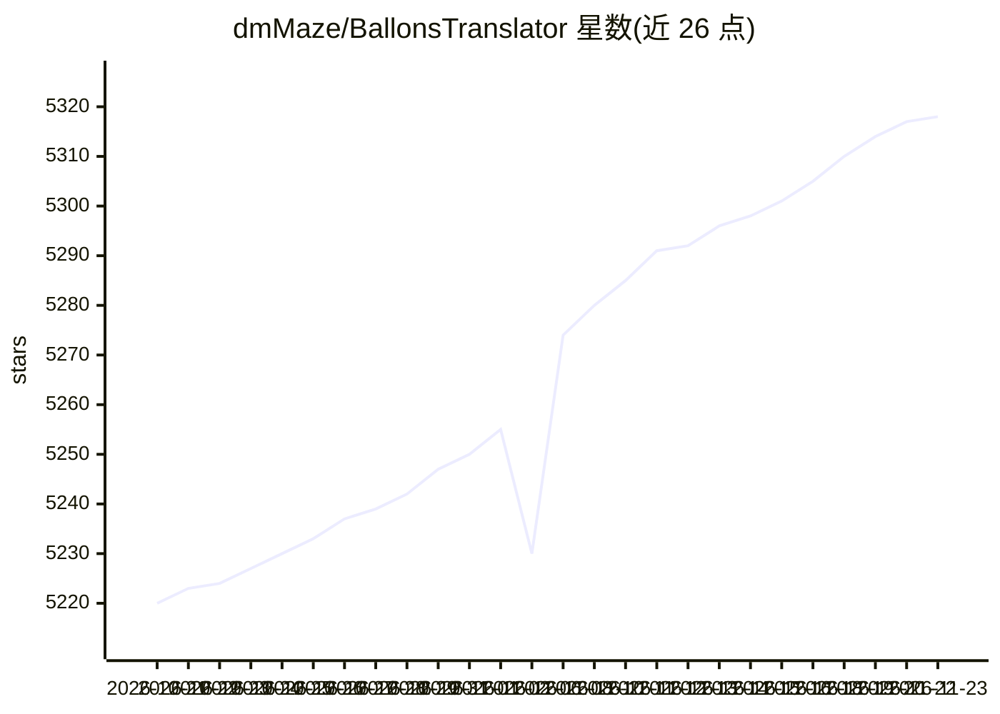

# dmMaze/BallonsTranslator

⭐ 5,318 · Python · GPL-3.0 · 推送 2026-11-21 · [GitHub](https://github.com/dmMaze/BallonsTranslator) · 个人维护 · 中文 README

**面向漫画读者的深度学习辅助漫画翻译与嵌字工具**

基于深度学习的桌面端（PyQt）漫画翻译工具，串联文本检测、OCR、图像修复（抹字）、机器翻译四个模块，支持一键机翻、译文回填原文排版（颜色/轮廓/角度/对齐），并提供掩膜编辑、修复画笔、富文本编辑、Word 导入导出等编辑功能。内置 LLM 翻译支持翻译历史、术语表、视觉上下文与摘要记忆机制。提供 Windows/macOS/Linux 图形界面与无 GUI 命令行模式；文本检测目前仅支持日文和英文，机翻结果需注明方可公开分享。

## 筛选速览

| 维度 | 判定 | 备注 |
|---|---|---|
| AI 角色 | `ai-native` | 本体是模型或模型工具 |
| 许可风险 | `viral` | GPL-3.0 |
| 部署形态 | `desktop` | 安装包/桌面程序 |
| 模型依赖 | — | README 未给出锁定关系 |
| 硬件要求 | — | 无带数字的原话,不猜 |
| 安装摩擦 | `medium` | 含编译或系统依赖之一 |
| 成熟度 | — | 结构信号不足 |

## 能力要点

- 一键机翻：文本检测、OCR、抹字、机翻四模块流水线
- LLM 翻译支持上下文历史、术语表注入、视觉模型与摘要/记忆
- 支持掩膜编辑与修复画笔（AOT/lama/patchmatch）
- 提供无 GUI 命令行批处理模式

## 适用场景

- 批量机翻日漫/美漫页面并保留原排版
- 翻译后手动修字、调字体样式再嵌字导出
- 用术语表统一人名与设定词的 LLM 长篇翻译

## 场景标签

`图像视频处理` `OCR` · 领域:感知与多模态

## 证据(README 行号)

> L9:  深度学习辅助漫画翻译工具，支持一键机翻和简单的图像/文本编辑
> L23:  - 最后效果取决于文本检测，识别，抹字，机翻四个模块的整体表现
> L222: * 电脑带 Nvidia 显卡或 Apple silicon 默认启用 GPU 加速

## 星数曲线

2026-10-21 5,220 → 2026-11-23 5,318（+98）

---
*卡片 v1 · prompt 1.4 · 生成 2026-11-23 · 置信度 high · 依据 README sha `0a0bb8a1b4b5` · [字段定义](../../DATASET.md)*
