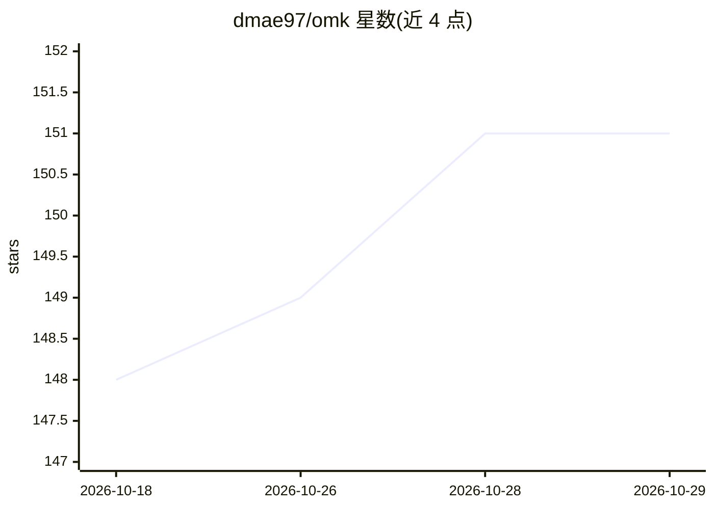

# dmae97/omk

⭐ 151 · TypeScript · MIT · 推送 2026-10-28 · [GitHub](https://github.com/dmae97/omk) · 个人维护

**终端编码 agent CLI：同一会话切换模型，目标以测试通过为准**

独立终端编码代理（非 Claude Code/OpenCode 插件），单 agent 工具循环起步，可选子代理、MCP 服务器与扩展。核心机制是 /goal verify：用户指定验收命令，每轮结束后运行，仅当检查通过才完成目标，之后的编辑会使凭证失效。支持 /model 会话内切换模型、/resume 恢复会话，兼容订阅、API key 与本地模型。内置 bash 默认沙箱化（macOS sandbox-exec / Linux bwrap），断网且缺失后端即失败关闭。二进制或 npm 安装。

## 筛选速览

| 维度 | 判定 | 备注 |
|---|---|---|
| AI 角色 | `ai-native` | 本体是模型或模型工具 |
| 许可风险 | `none` | MIT |
| 部署形态 | `library` | 以包/库形式分发 |
| 模型依赖 | — | README 未给出锁定关系 |
| 硬件要求 | — | 无带数字的原话,不猜 |
| 安装摩擦 | `low` | 无编译、无系统依赖或容器化 |
| 成熟度 | — | 结构信号不足 |

## 能力要点

- /goal verify 验收门：目标仅在指定检查命令通过时完成，编辑后凭证失效
- 会话内 /model 切换模型，支持订阅、API key 与本地模型
- 内置 bash 默认沙箱（sandbox-exec/bwrap，无网络，失败关闭）
- 子代理、MCP、技能与扩展均为显式 opt-in，默认不加载

## 适用场景

- 让编码 agent 修 bug 并用项目自带测试作为完成判定
- 在同一个会话里换用不同模型完成不同步骤
- 以隔离沙箱运行 agent 的 shell 命令

## 场景标签

`编码 Agent` · 领域:编码与开发

## 证据(README 行号)

> L12:  A terminal coding agent with model switching and explicit, test-backed goals.
> L30: An AI saying “done” is not an acceptance check. With `/goal verify`, you choose
> L44: Choose a model, work on your repository, then switch models with `/model` when

## 星数曲线

2026-10-18 148 → 2026-10-29 151（+3）

---
*卡片 v1 · prompt 1.4 · 生成 2026-10-22 · 置信度 high · 依据 README sha `51f4ac0f91d6` · [字段定义](../../DATASET.md)*
