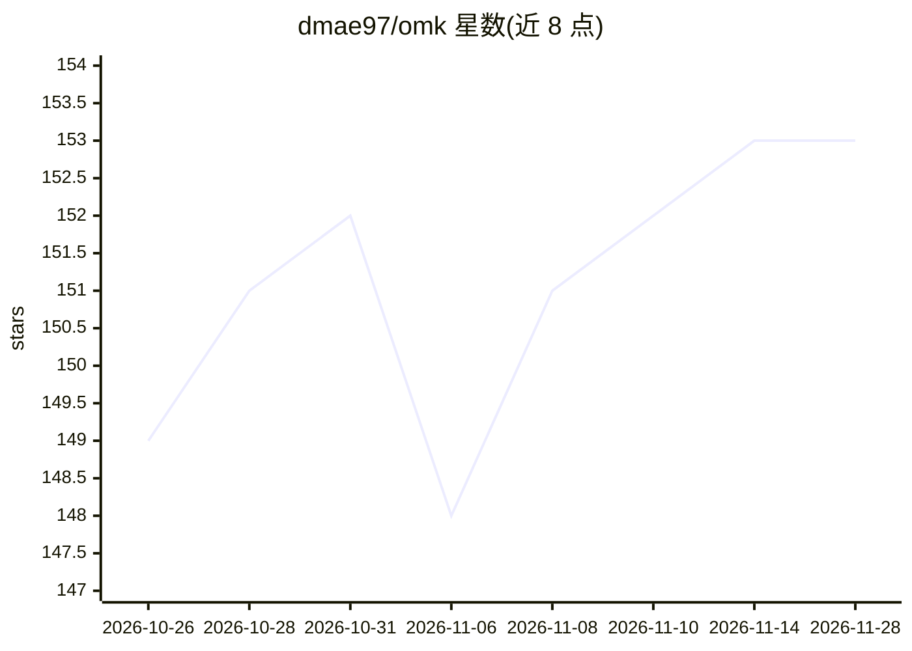

# dmae97/omk

⭐ 153 · TypeScript · MIT · 推送 2026-11-27 · [GitHub](https://github.com/dmae97/omk) · 个人维护

**开源终端 AI 编码 agent：跨模型切换并以自定义检查门控完成目标**

OMK（Open Multi-Agent Kit）是 TypeScript 编写、MIT 许可的终端 CLI 编码 agent。核心机制：`/goal verify <命令>` 定义验收命令，每轮稳定后重跑，仅当退出码为 0 才判定目标完成；`/model` 支持同一会话内切换模型，`/resume` 恢复会话。默认只启动单个 agent 循环，subagents、MCP、skills、extensions 均需显式配置；内置 bash 默认在 sandbox-exec/bwrap 下无网络运行并 fail-closed。支持订阅、API key 与本地模型登录，可复用 Claude Code/Codex CLI 凭据。Rust 核心迁移尚未完成，2.0.0 仍是 Node 运行时。

## 筛选速览

| 维度 | 判定 | 备注 |
|---|---|---|
| AI 角色 | `ai-ecosystem` | LLM/agent 周边工具 |
| 许可风险 | `permissive` | MIT |
| 部署形态 | `library` | 以包/库形式分发 |
| 模型依赖 | — | README 未给出锁定关系 |
| 硬件要求 | — | 无带数字的原话,不猜 |
| 安装摩擦 | `low` | 无编译、无系统依赖或容器化 |
| 成熟度 | — | 结构信号不足 |

## 能力要点

- /goal verify 验收门控：检查命令通过才算目标完成
- 同一会话内用 /model 切换模型，/resume 续接
- 内置 bash 默认沙箱化（sandbox-exec/bwrap），无网络、fail-closed
- 支持订阅、API key、本地模型三种登录方式

## 适用场景

- 让 agent 修复失败的测试，且断言不可更改、测试通过才算完成
- 在编码会话中按步骤切换不同模型并保留上下文
- 在受限沙箱中让 agent 运行命令而不开放网络

## 场景标签

`编码 Agent` · 领域:编码与开发

## 证据(README 行号)

> L116: OMK is a lightweight, MIT-licensed AI coding agent for your terminal, written in
> L119: can serve as an open-source alternative to a single-provider agent such as
> L175: OMK is a standalone CLI, not a plugin for Claude Code or OpenCode. It supports

## 星数曲线

2026-10-26 149 → 2026-11-28 153（+4）

---
*卡片 v1 · prompt 1.4 · 生成 2026-11-28 · 置信度 mid · 依据 README sha `901bedcc69b7` · [字段定义](../../DATASET.md)*
