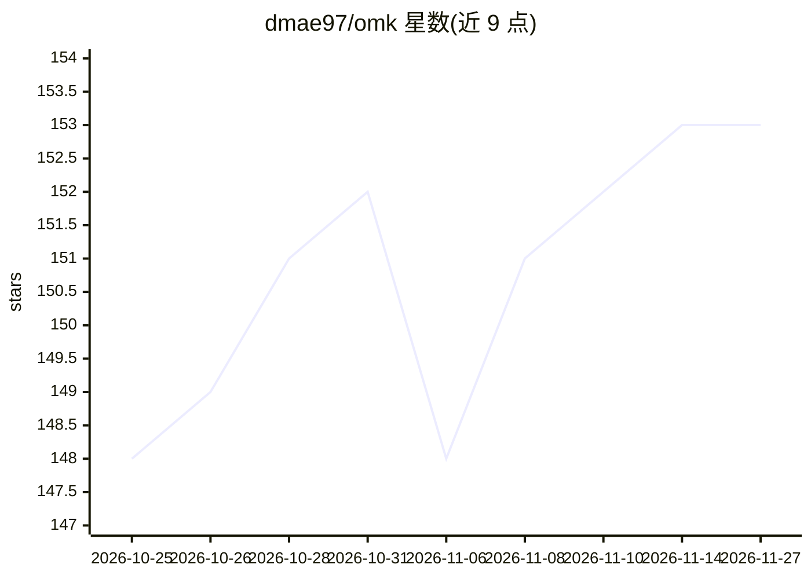

# dmae97/omk

⭐ 153 · TypeScript · MIT · 推送 2026-11-26 · [GitHub](https://github.com/dmae97/omk) · 个人维护

**终端里的开源 AI 编码代理：用自定检查命令判定目标完成**

OMK 是用 TypeScript 编写、MIT 许可的终端 AI 编码代理 CLI。核心机制：/goal verify 让用户自定检查命令，每轮结束后自动重跑，仅当检查退出码为 0 时目标才标记完成；同一会话内可用 /model 切换模型，/resume 或 omk -c 恢复会话。默认只启动单代理循环，子代理、MCP 服务器、技能与扩展均需显式配置；内置 bash 沙箱默认无网络并在后端缺失时失败关闭。需 Node.js 22.19+ 或独立二进制，登录支持订阅、API key 或本地模型。

## 筛选速览

| 维度 | 判定 | 备注 |
|---|---|---|
| AI 角色 | `ai-native` | 本体是模型或模型工具 |
| 许可风险 | `permissive` | MIT |
| 部署形态 | `library` | 以包/库形式分发 |
| 模型依赖 | — | README 未给出锁定关系 |
| 硬件要求 | — | 无带数字的原话,不猜 |
| 安装摩擦 | `low` | 无编译、无系统依赖或容器化 |
| 成熟度 | — | 结构信号不足 |

## 能力要点

- /goal verify 验证门：检查命令通过后目标才完成，每轮 settled turn 后重跑
- 一个会话内用 /model 切换多个模型，/resume 或 omk -c 恢复
- 内置 bash 沙箱（sandbox-exec/bwrap），默认无网络且失败关闭
- 子代理、MCP、技能与扩展均为 opt-in，可复用 Claude Code/Codex CLI 登录

## 适用场景

- 在终端里让代理修复失败的测试，且以自己项目的测试命令作为完成判据
- 在同一会话中对比不同模型对同一任务的处理结果
- 为扩展编写 omk 原生包并迁移旧的 Pi 清单

## 场景标签

`编码 Agent` · 领域:编码与开发

## 证据(README 行号)

> L6:  An open-source AI coding agent for your terminal: switch models in one
> L107: OMK is a lightweight, MIT-licensed AI coding agent for your terminal, written in
> L148: An AI saying “done” is not an acceptance check. With `/goal verify`, you choose

## 星数曲线

2026-10-25 148 → 2026-11-27 153（+5）

---
*卡片 v1 · prompt 1.4 · 生成 2026-11-27 · 置信度 high · 依据 README sha `1501611b95a3` · [字段定义](../../DATASET.md)*
