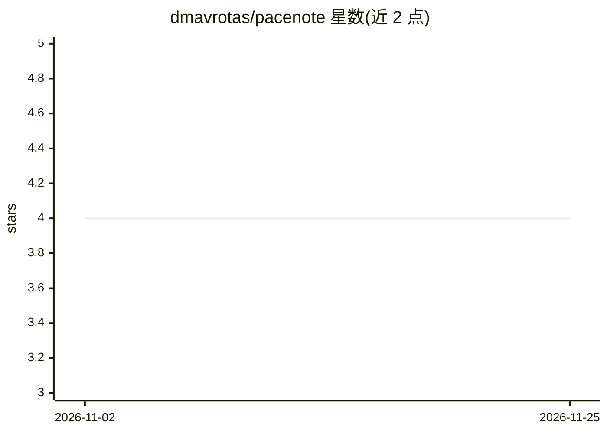

# dmavrotas/pacenote

⭐ 4 · Rust · Apache-2.0 · 推送 2026-11-22 · [GitHub](https://github.com/dmavrotas/pacenote) · 个人维护

**Claude Code 的令牌用量分析与提示词检查 CLI 工具**

单个 Rust 二进制，与 Claude Code 配合使用：stats 子命令读取本地会话转录，按模型、项目与工具输出统计令牌去向，并按 requestId 去重；hook prompt 作为 UserPromptSubmit 钩子在提交前检查提示词（模糊目标、超大粘贴、缺少完成标准），反馈经 systemMessage 返回，不写入 Claude 上下文；rewrite 支持本地确定性重写（裁剪粘贴、补文件提示），可选 LLM 模式调用 Anthropic API。全部本地运行、无网络调用（LLM 模式除外）。

## 筛选速览

| 维度 | 判定 | 备注 |
|---|---|---|
| AI 角色 | `ai-ecosystem` | LLM/agent 周边工具 |
| 许可风险 | `permissive` | Apache-2.0 |
| 部署形态 | `library` | 以包/库形式分发 |
| 模型依赖 | — | README 未给出锁定关系 |
| 硬件要求 | — | 无带数字的原话,不猜 |
| 安装摩擦 | `low` | 无编译、无系统依赖或容器化 |
| 成熟度 | — | 结构信号不足 |

## 能力要点

- 读取本地会话转录，按 requestId 去重统计令牌用量（支持 --json 输出）
- UserPromptSubmit 钩子在提交前检查提示词，反馈零令牌开销
- 本地确定性重写：裁剪大粘贴、追加文件位置提示
- 支持 5 种语言的提示词 lint，词包可扩展

## 适用场景

- 查看 Claude Code 会话中令牌被哪些项目与工具输出消耗
- 提交提示词前拦截模糊指令与超大粘贴
- 团队共享的提示词规范检查钩子配置

## 场景标签

`提示工程` `LLM 可观测性` · 领域:Agent 开发

## 证据(README 行号)

> L9: pacenote is a single, fast Rust binary that works alongside Claude Code:
> L11: - **`pacenote stats`** reads your local session transcripts and shows where your tokens actually go: by model, by p
> L12: - **`pacenote hook prompt`** is a `UserPromptSubmit` hook that warns you, before Claude starts, when a prompt is va

## 星数曲线

2026-11-02 4 → 2026-11-25 4（+0）

---
*卡片 v1 · prompt 1.4 · 生成 2026-11-21 · 置信度 high · 依据 README sha `61a401cfc4f4` · [字段定义](../../DATASET.md)*
