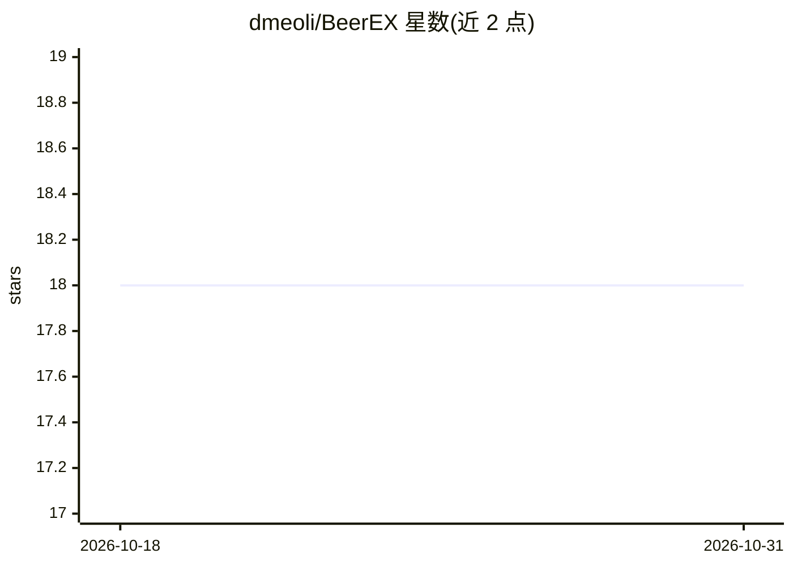

# dmeoli/BeerEX

⭐ 18 · CLIPS · MIT · 推送 2026-10-18 · [GitHub](https://github.com/dmeoli/BeerEX) · [官网](https://t.me/BeerEXpertBot) · 个人维护

**推荐啤酒的规则式专家系统，Telegram 机器人形式**

基于 CLIPS 的规则式专家系统，以 Telegram 机器人和命令行 REPL 两种形式提供：根据用户口味与餐食，在由 CraftBeer.com 指南构建的啤酒风格知识库上推理并推荐啤酒。支持运行时切换两种推理后端（MYCIN 式确定性因子 / 模糊逻辑，隶属函数由 ABV/IBU/SRM 真实数据推导），可为每次提问与推荐给出解释。知识库提取脚本可复现，含 Docker 镜像与 CI。开发于巴里大学知识工程课程，比萨大学 AI 基础课程中修订。

## 筛选速览

| 维度 | 判定 | 备注 |
|---|---|---|
| AI 角色 | `ai-native` | 本体是模型或模型工具 |
| 许可风险 | `permissive` | MIT |
| 部署形态 | `self-host` | docker 或自建部署 |
| 模型依赖 | — | README 未给出锁定关系 |
| 硬件要求 | — | 无带数字的原话,不猜 |
| 安装摩擦 | `low` | 无编译、无系统依赖或容器化 |
| 成熟度 | — | 结构信号不足 |

## 能力要点

- 运行时可切换的两种推理后端（确定性因子 / 模糊逻辑）
- 从 CraftBeer 指南挖掘的啤酒风格知识库（数值区间+定性画像+配餐）
- 逐条透明的解释（提问原因与推荐依据）
- 纯 CLIPS 编写的可复用模糊逻辑库（git submodule，带差分测试）

## 适用场景

- 通过 Telegram 对话获得按口味和餐食的啤酒推荐
- 查看推荐背后的推理依据
- 作为 CLIPS 专家系统或模糊逻辑的教学示例

## 场景标签

`教程课程` · 领域:学习与行业

## 证据(README 行号)

> L10: **BeerEX** is a rule-based expert system, available as a Telegram bot,
> L27: - **Two reasoning backends, switchable at runtime** (`/cf` · `/fuzzy`):

## 星数曲线

2026-10-18 18 → 2026-10-31 18（+0）

---
*卡片 v1 · prompt 1.4 · 生成 2026-10-29 · 置信度 mid · 依据 README sha `3be65f74c9a5` · [字段定义](../../DATASET.md)*
