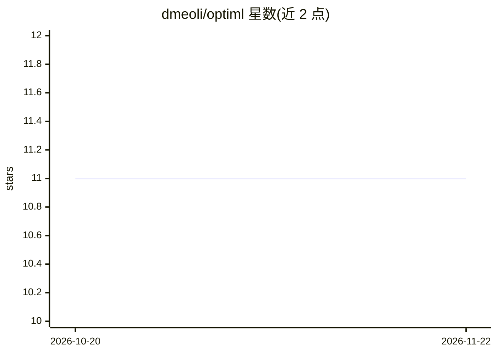

# dmeoli/optiml

⭐ 11 · Python · MIT · 推送 2026-09-14 · [GitHub](https://github.com/dmeoli/optiml) · 组织维护

**sklearn 兼容的 SVM 与深度神经网络优化求解库**

OptiML 提供 sklearn 兼容接口的 Support Vector Machines 与 Deep Neural Networks 实现，核心是通过多种数值优化算法求解这些模型数学形式导出的优化问题。项目源于比萨大学计算机科学系《数值方法与优化》课程的研究工作，涵盖凸优化、对偶、拉格朗日松弛等主题。以 Python 包形式发布到 PyPI，提供基于 Sphinx 构建的 API 文档，采用 MIT 许可证。

## 筛选速览

| 维度 | 判定 | 备注 |
|---|---|---|
| AI 角色 | `ai-native` | 本体是模型或模型工具 |
| 许可风险 | `permissive` | MIT |
| 部署形态 | `library` | 以包/库形式分发 |
| 模型依赖 | — | README 未给出锁定关系 |
| 硬件要求 | — | 无带数字的原话,不猜 |
| 安装摩擦 | `low` | 无编译、无系统依赖或容器化 |
| 成熟度 | — | 结构信号不足 |

## 能力要点

- sklearn 兼容的 SVM 与深度神经网络实现
- 以多种优化算法求解模型优化问题
- PyPI 发布并托管 Sphinx API 文档

## 适用场景

- 在教学或研究中使用不同优化算法训练 SVM 与神经网络
- 为数值优化课程实验提供模型实现参考

## 场景标签

 · 领域:机器学习/数值优化

## 证据(README 行号)

> L12: OptiML is a sklearn compatible implementation of *Support Vector Machines* and *Deep Neural Networks*, both with so
> L17: for the Numerical Methods and Optimization course @ Department of Computer Science @

## 星数曲线

2026-10-20 11 → 2026-11-22 11（+0）

---
*卡片 v1 · prompt 1.4 · 生成 2026-11-18 · 置信度 high · 依据 README sha `5a8f4fac0651` · [字段定义](../../DATASET.md)*
