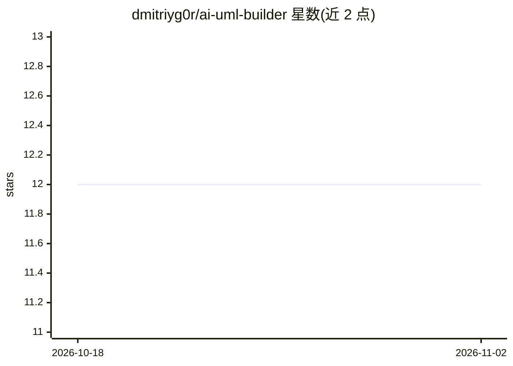

# dmitriyg0r/ai-uml-builder

⭐ 12 · TypeScript · NOASSERTION · 推送 2026-02-06 · [GitHub](https://github.com/dmitriyg0r/ai-uml-builder) · 个人维护

**自然语言生成 UML 图的跨平台桌面应用（Tauri）**

基于 React 19/TypeScript/Tauri 2.0 的桌面应用，用户以英语或俄语描述系统、类或流程，通过 Polza AI（DeepSeek 集成）生成 Mermaid 代码并渲染为类图、时序图、流程图、ER 图等，支持迭代修改、语法高亮编辑、实时预览与 SVG/PNG 导出。提供访客模式（3 次 AI 请求）、自托管认证同步、英/俄双语界面。生成需 API 联网，编辑可离线。采用专有许可，商业使用需联系作者授权。

## 筛选速览

| 维度 | 判定 | 备注 |
|---|---|---|
| AI 角色 | `ai-native` | 本体是模型或模型工具 |
| 许可风险 | `none` | NOASSERTION |
| 部署形态 | `library` | 以包/库形式分发 |
| 模型依赖 | locked-api |  |
| 硬件要求 | — | 无带数字的原话,不猜 |
| 安装摩擦 | `low` | 无编译、无系统依赖或容器化 |
| 成熟度 | — | 结构信号不足 |

## 能力要点

- 自然语言（英/俄）生成 Mermaid 图，支持类图/时序图/流程图/ER 图/状态图
- 基于 Tauri 的跨平台桌面应用（Windows MSI/macOS DMG/Linux AppImage）
- 访客模式免注册 3 次 AI 请求，自托管 API 认证同步
- AI 自动生成对话标题，SVG/PNG 导出与实时预览编辑

## 适用场景

- 用自然语言快速生成软件架构或类图文档
- 学生学习 UML 与系统设计并可视化练习
- 技术写作者将流程描述转为可导出的图表

## 场景标签

 · 领域:开发工具/图表可视化

## 证据(README 行号)

> L21: AI UML Builder is a **powerful desktop application** that converts natural language descriptions into beautiful, pr
> L267: - 🤖 **Polza AI** - DeepSeek AI integration

## 星数曲线

2026-10-18 12 → 2026-11-02 12（+0）

---
*卡片 v1 · prompt 1.4 · 生成 2026-11-01 · 置信度 high · 依据 README sha `e35af7994977` · [字段定义](../../DATASET.md)*
